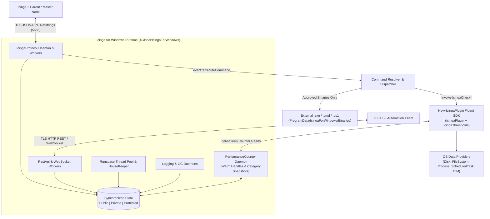
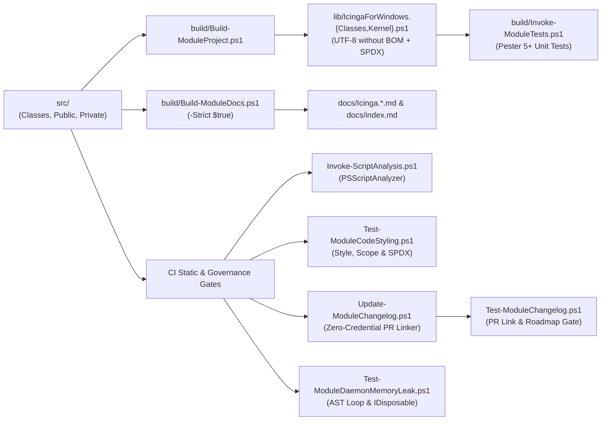

[](https://learn.microsoft.com/en-us/powershell/scripting/install/installing-powershell-on-windows)
[](LICENSE)
[](https://github.com/Icinga/IcingaForWindows/actions/workflows/ci.yml)
[](https://github.com/Icinga/IcingaForWindows/releases)
[](https://github.com/Icinga/IcingaForWindows/issues)
[](https://github.com/Icinga/IcingaForWindows/pulls)

# Icinga for Windows

**Icinga for Windows** (`v27.0.0`) is a unified, multi-threaded PowerShell monitoring platform and native Icinga 2 agent runtime for Windows Server and Windows client hosts.

All subsystems -- background daemons, the native Icinga 2 JSON-RPC protocol stack, the HTTPS REST API, the performance counter engine, and built-in or custom monitoring plugins -- coordinate through a single synchronized `$Global:IcingaForWindows` runtime state partitioned into `Public` (shared thread-safe queues and configuration), `Private` (runspace-local worker context), and `Protected` (environment metadata).

---

## Architecture Overview

**Icinga for Windows** is organized into focused, single-function source files under `src/` that compile into two BOM-less UTF-8 runtime artifacts (`lib/IcingaForWindows.Classes.ps1` and `lib/IcingaForWindows.Kernel.ps1`):

* **Core (`Runtime`, `Threading`, `Logging`, `ErrorHandling`)** -- Host installation and runtime bootstrap (`Install-IcingaForWindows`, `Use-IcingaForWindows`), runspace pool thread management (`New-Thread`, `Start-ThreadHouseKeeper`), Windows Event Log registration and structured logging queue (`Register-LoggingWindowsEventLog`, `Write-LoggingEntry`), garbage collection, and semantic internal return codes (`Set-InternalExitCodes`).
* **Core Network (`TCPStack`, `RestApi`, `WebSocket`, `AccessControl`)** -- TLS 1.2+ socket and certificate configuration (`New-IcingaTlsCertConfig`), multi-worker HTTPS REST API (`Start-RestApiDaemon`), persistent WebSocket client workers (`Start-ModuleWebSocketDaemon`), and role-based access control.
* **Icinga Protocol (`IcingaProtocol`)** -- Certificate and cluster configuration (`New-IcingaProtocolCertificate`, `Import-IcingaCertAuthority`, `New-IcingaProtocolEnvironment`), native Icinga 2 JSON-RPC netstring listener/connector (`Start-IcingaAgent`), and secure `event::ExecuteCommand` check dispatch for `Invoke-IcingaCheck*` cmdlets and approved external binaries/scripts inside `$env:ProgramData\IcingaForWindows\Binaries`.
* **Performance Counter Engine (`PerformanceCounter`)** -- Dedicated background daemon (`Start-IcingaPerformanceCounterDaemon`), category-level bulk snapshots, static AST counter pre-warming at startup, and automatic inline session fallback.
* **Monitoring Plugins & Public SDK (`Plugins`, `Classes`)** -- Fluent `IcingaPlugin` check/package framework, public `New-IcingaPlugin` SDK cmdlet, `IcingaThresholds` and `IcingaUnit` engines, OS data providers (`Disk`, `FileSystem`, `Process`, `ScheduledTask`), and nine built-in monitoring checks (`CPU`, `Directory`, `Memory`, `PartitionSpace`, `PerfCounter`, `Process`, `ScheduledTask`, `Service`, `Uptime`).
* **Configuration, Security & Tools (`Config`, `Security`, `Tools`)** -- Approved-path filesystem wrappers, Windows PowerShell 5.1 memory-safe JSON serialization (`ConvertFrom-ModuleJson` / `ConvertTo-ModuleJson`), unit conversion, natural sorting, and `SecureString` helpers.

### Runtime & Check Execution Flow



### Build, Documentation & CI Governance Pipeline



---

## Quick Start & Base Setup

**Requirements:** Windows PowerShell 5.1 or PowerShell 7.5+ on Windows Server / Windows 11 (run initial host setup in an **elevated Administrator** session). For local development and unit testing, the module also imports cleanly on Linux and macOS via the `$env:ProgramData` home-directory fallback.

For a complete walkthrough covering CA import, certificate signing, connection modes, and verification, see the **[Step-by-Step Installation Guide](docs/General/Installation.md)**.

```powershell
# Import the Icinga for Windows module once per PowerShell session
Import-Module IcingaForWindows -Force -Global;

# 1. Base host installation (run as Administrator on Windows):
#    Creates ProgramData\IcingaForWindows\{Config,Binaries}, registers Windows Event Log
#    sources (100 MiB), and generates the initial self-signed TLS certificate (returns 7001)
Install-IcingaForWindows -Hostname 'win-srv01.example.com';

# 2. Import the Icinga 2 CA certificate into Cert:\LocalMachine\Root on Windows
#    (required for outbound TLS peer verification unless already trusted via Group Policy)
Import-IcingaCertAuthority -Path 'C:\Temp\ca.crt';

# 3a. Optional preview: inspect unified diff against existing Connection.json (-DryRun does NOT save changes)
(
    New-IcingaProtocolEnvironment `
        -Endpoints @(
            (New-IcingaProtocolEndpoint -Name 'icinga-master01.example.com' -Address 'icinga-master01.example.com' -Port 5665),
            (New-IcingaProtocolEndpoint -Name 'icinga-master02.example.com' -Address 'icinga-master02.example.com' -Port 5665)
        ) `
        -Zone 'master' `
        -Hostname '$fqdn' `
        -TlsCertConfig (
            New-IcingaTlsCertConfig `
                -CertCN '$fqdn' `
                -CertStore 'My' `
                -CertStoreLocation 'CurrentUser' `
                -CertIssuer @( 'Icinga CA', '$fqdn' )
        ) `
        -DryRun
).Output;

# 3b. Save configuration: run again WITHOUT -DryRun and WITHOUT .Output to write Connection.json (returns 50019)
New-IcingaProtocolEnvironment `
    -Endpoints @(
        (New-IcingaProtocolEndpoint -Name 'icinga-master01.example.com' -Address 'icinga-master01.example.com' -Port 5665),
        (New-IcingaProtocolEndpoint -Name 'icinga-master02.example.com' -Address 'icinga-master02.example.com' -Port 5665)
    ) `
    -Zone 'master' `
    -Hostname '$fqdn' `
    -TlsCertConfig (
        New-IcingaTlsCertConfig `
            -CertCN '$fqdn' `
            -CertStore 'My' `
            -CertStoreLocation 'CurrentUser' `
            -CertIssuer @( 'Icinga CA', '$fqdn' )
    );

# 4. Start the runtime and background daemons in the current session (or use Exit-Icinga to terminate later)
Use-IcingaForWindows -NoNewShell -LogLevel 'Info' -RunBackgroundDaemons;

Invoke-IcingaCheckCPU -Warning '80' -Critical '95';
Invoke-IcingaCheckMemory -Warning '85%' -Critical '95%';
Invoke-IcingaCheckPartitionSpace -Warning '80%' -Critical '90%';
```

**Node Identity, `-DryRun` Preview & Placeholders:**
* **`-DryRun` Preview vs. Saving Configuration:** Passing `-DryRun` returns a diff hashtable (`@{ ExitCode; Output }`) via `Compare-IcingaTextContent` and **does not save the configuration**. After inspecting `(... -DryRun).Output`, run `New-IcingaProtocolEnvironment` **without `-DryRun` and without `.Output`** to write `Config\IcingaProtocol\Connection.json` to disk (`50019`).
* **Icinga 2 Object Name:** The node `-Hostname` and certificate Common Name (`CN`) **must match the exact `Endpoint` and `Host` Object Name** configured in Icinga 2 / Icinga Director. Pass the concrete node name to `Install-IcingaForWindows -Hostname` (for example `'win-srv01.example.com'` / `([System.Net.Dns]::GetHostEntry('').HostName)` for FQDN Object Names, or `([System.Net.Dns]::GetHostName())` for short-hostname Object Names).
* **Runtime Placeholders (`'$fqdn'` & `'$hostname'`):** Inside `New-IcingaProtocolEnvironment` and `New-IcingaTlsCertConfig`, single-quoted, lowercase `'$fqdn'` and `'$hostname'` are stored verbatim in `Config\IcingaProtocol\Connection.json` and dynamically resolved whenever the configuration is loaded (`$fqdn` -> `[System.Net.Dns]::GetHostEntry('').HostName`, `$hostname` -> `[System.Net.Dns]::GetHostName()`). Always wrap them in **single quotes** (`'$fqdn'`, `'$hostname'`) so PowerShell does not expand them as empty shell variables, and choose whichever matches your Icinga 2 Object Name.
* **Bootstrap & Signed Certificate Matching:** `Install-IcingaForWindows` stores the node certificate in `Cert:\CurrentUser\My` (`-CertStore 'My' -CertStoreLocation 'CurrentUser'`). Passing `-CertIssuer @( 'Icinga CA', '$fqdn' )` (or `'$hostname'`) allows the TLS loader to match both the initial self-signed certificate created by `Install-IcingaForWindows` and the final certificate signed by `'Icinga CA'` without rewriting `Connection.json`.

---

## Writing Custom Plugins (`New-IcingaPlugin` SDK)

External modules and custom check scripts build checks through the exported `New-IcingaPlugin` cmdlet without referencing internal PowerShell class literals directly:

```powershell
function Invoke-IcingaCheckCustomQueue()
{
    param (
        [string]$Warning    = $null,
        [string]$Critical   = $null,
        [int]$Verbosity     = 0,
        [switch]$NoPerfData = $false
    );

    $Package = New-IcingaPlugin -Name 'Message Queues';
    $Package.SetNoPerfData($NoPerfData).SetVerbose($Verbosity).Commit();

    $QueueCheck = New-IcingaPlugin -Name 'Orders Queue' -Value 42 -Unit 'c';
    $QueueCheck.Warning($Warning).Critical($Critical).CheckRange().Commit();
    $Package.AddCheck($QueueCheck).Commit();

    return $Package.Compile();
}
```

See the [Custom Plugin Developer Guide](docs/Developer/Plugins/04-Custom-Plugin-Developer-Guide.md) for full details on composite packages, units, thresholds, error handling, and unit testing.

---

## Developer Build & Validation Commands

Compiled files under `lib/` and API reference pages (`docs/Icinga.*.md`, `docs/index.md`) are **auto-generated** -- never edit them by hand.

```powershell
# 1. Compile src/ -> lib/ and run AST daemon memory-leak validation
.\build\Build-ModuleProject.ps1 -SkipTests -TestDaemonMemoryLeaks;

# 2. Regenerate strict Markdown API documentation (verifies .NOTES + SPDX across all functions)
.\build\Build-ModuleDocs.ps1 -Strict $true;

# 3. Validate repository-wide PowerShell code styling, function scope, and SPDX headers
.\build\Test-ModuleCodeStyling.ps1;

# 4. Validate Changelog.md and Roadmap.md (enforces changelog entries & PR links before merge)
.\build\Test-ModuleChangelog.ps1;

# 5. Stamp [#<PR>](.../pull/<PR>) onto newly added Changelog.md bullets (zero credentials required)
.\build\Update-ModuleChangelog.ps1;

# 6. Run PSScriptAnalyzer static analysis
.\build\Invoke-ScriptAnalysis.ps1 -FailOn 'Warning';

# 7. Execute the Pester unit test suite
.\build\Invoke-ModuleTests.ps1;
```

---

## Documentation Map

### General & Governance
* [Step-by-Step Installation Guide](docs/General/Installation.md)
* [Changelog](docs/General/Changelog.md) · [Roadmap](docs/General/Roadmap.md)
* [Code, Architecture & Documentation Ruleset (`01-Instruction.md`)](docs/Agents/guidelines/01-Instruction.md)
* [Knowledgebase (`IWKB001xxx`)](docs/Knowledgebase/index.md)

### Developer Architecture Guides
* [Threading & Runspace Class Isolation](docs/Developer/Threading/01-Threading.md) · [Daemon Memory-Leak Prevention](docs/Developer/CodeQuality/01-MemoryLeaks.md)
* [Icinga 2 Check & Binary Execution Pipeline](docs/Developer/IcingaProtocol/01-Check-and-Binary-Execution.md)
* [Performance Counter Architecture](docs/Developer/PerformanceCounter/01-Technical-Architecture-and-Reference.md) · [Performance Counter Developer Guide](docs/Developer/PerformanceCounter/02-Usability-and-Developer-Guide.md)
* [Plugin Architecture & Concepts](docs/Developer/Plugins/01-Architecture-and-Concepts.md) · [`IcingaPlugin` Reference](docs/Developer/Plugins/02-IcingaPlugin-Reference.md) · [Result & Error Objects](docs/Developer/Plugins/03-Result-and-Error-Objects.md) · [Custom Plugin Developer Guide](docs/Developer/Plugins/04-Custom-Plugin-Developer-Guide.md)

### Auto-Generated Component API Reference
* **[API Reference Index](docs/index.md)** -- Complete index of all public cmdlets and private helpers
* **Monitoring & Protocol:** [Monitoring Checks](docs/Icinga.Plugins.Checks.md) · [Plugin SDK (`Plugins.Lib`)](docs/Icinga.Plugins.Lib.md) · [Icinga Protocol](docs/Icinga.IcingaProtocol.md) · [Performance Counter](docs/Icinga.PerformanceCounter.md)
* **OS Data Providers:** [Disk](docs/Icinga.Plugins.Provider.Disk.md) · [FileSystem](docs/Icinga.Plugins.Provider.FileSystem.md) · [Process](docs/Icinga.Plugins.Provider.Process.md) · [ScheduledTask](docs/Icinga.Plugins.Provider.ScheduledTask.md)
* **Core Runtime & Network:** [Runtime](docs/Icinga.Core.Runtime.md) · [Threading](docs/Icinga.Core.Threading.md) · [Logging](docs/Icinga.Core.Logging.md) · [Error Handling](docs/Icinga.Core.ErrorHandling.md) · [TCP Stack](docs/Icinga.Core.TCPStack.md) · [REST API](docs/Icinga.Core.RestApi.md) · [WebSocket](docs/Icinga.Core.WebSocket.md) · [Access Control](docs/Icinga.Core.AccessControl.md)
* **Platform Utilities:** [Configuration](docs/Icinga.Config.md) · [Security](docs/Icinga.Security.md) · [Tools](docs/Icinga.Tools.md)

---

## Contributing

**Icinga for Windows** is an open-source project and welcomes bug reports, feature requests, documentation improvements, and pull requests:

1. Check the [Issue Tracker](https://github.com/Icinga/IcingaForWindows/issues) and [Roadmap](docs/General/Roadmap.md) before starting work.
2. Follow all code-styling, runspace-isolation, `.NOTES`, and SPDX licensing rules in [`docs/Agents/guidelines/01-Instruction.md`](docs/Agents/guidelines/01-Instruction.md).
3. Add a changelog bullet entry under the current unreleased version in [`docs/General/Changelog.md`](docs/General/Changelog.md) on every pull request / feature branch (`build/Test-ModuleChangelog.ps1`). Once your Pull Request is open on GitHub, internal repository branches are linked automatically by CI (`changelog-link`), or fork contributors can run `.\build\Update-ModuleChangelog.ps1` locally with zero credentials to stamp `[#<PR>](https://github.com/Icinga/IcingaForWindows/pull/<PR>)` before merging into `main`.
4. Verify all build, documentation, styling, memory-leak, and Pester checks pass before opening a [Pull Request](https://github.com/Icinga/IcingaForWindows/pulls).

---

## License

**Icinga for Windows** is licensed under the **GNU General Public License v3.0 or later (`GPL-3.0-or-later`)**. See [LICENSE](LICENSE) for the full license text.
