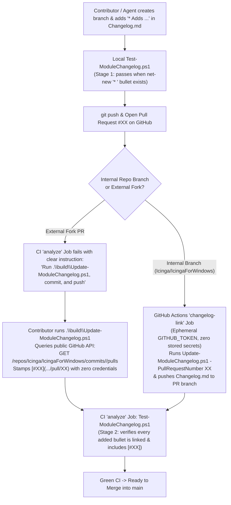

# Automated PR Changelog Linking & Pre-Merge CI Enforcement Plan (`changelog-pr-linking`)

## 1. Problem Statement & Objectives

Every feature, bugfix, security hardening, and documentation Pull Request merged into `main` in **Icinga for Windows** must carry its clickable `[#<PR>](https://github.com/Icinga/IcingaForWindows/pull/<PR>)` link inside [docs/General/Changelog.md](../../../General/Changelog.md) so release notes are 100% traceable without post-hoc commit archaeology.

At the same time, a Pull Request number does not exist yet when a contributor or AI coding agent first creates a branch locally, and external fork contributors do not have write access to repository secrets. The solution must therefore:

1. **Require zero stored credentials, PATs, API keys, or personal identities** anywhere in build scripts, GitHub Actions workflows, tests, or documentation.
2. **Work identically for internal maintainers, external fork contributors, and AI coding agents** across Windows PowerShell 5.1 and PowerShell 7.5+ on Windows, Linux, and macOS.
3. **Avoid chicken-and-egg friction during local pre-PR development** while **strictly blocking unlinked Pull Requests from merging into `main`** in CI.
4. **Support historical backfilling (`-SyncHistory`)** for previously merged commits on `27.0.0 (Unreleased)`.

---

## 2. Architecture & Design Decisions

### 2.1 Zero-Credential Security Model

- **Canonical Repository Resolution:** Both [build/Update-ModuleChangelog.ps1](../../../../build/Update-ModuleChangelog.ps1) and [build/Test-ModuleChangelog.ps1](../../../../build/Test-ModuleChangelog.ps1) read `PrivateData.PSData.ProjectUri` (`https://github.com/Icinga/IcingaForWindows`) directly from [IcingaForWindows.psd1](../../../../IcingaForWindows.psd1) rather than relying on `git remote get-url origin`. External fork checkouts whose `origin` points to `<fork-user>/IcingaForWindows` therefore resolve the canonical upstream repository URL automatically.
- **Unauthenticated Public GitHub REST API Lookup (`Update-ModuleChangelog.ps1`):** When `-PullRequestNumber` is not explicitly provided and `$env:GITHUB_EVENT_PATH` is absent, `Update-ModuleChangelog.ps1` queries `GET https://api.github.com/repos/Icinga/IcingaForWindows/commits/<SHA>/pulls`, falls back to fork-aware `GET /repos/Icinga/IcingaForWindows/pulls?state=open&head=<owner>:<branch>` (extracting remote GitHub owners from Git remotes without retaining any embedded userinfo), and finally checks bounded recent commits in `MergeBase..HEAD`. No `Authorization` header, token, or secret is used, and HTTP `403`/`429` or connectivity errors emit clear warnings rather than false-positive status messages.
- **Ephemeral `GITHUB_TOKEN` & Fork Isolation (`.github/workflows/ci.yml`):**
  - Top-level workflow permissions remain `contents: read`.
  - The `changelog-link` job runs strictly on `pull_request` events where `github.event.pull_request.head.repo.full_name == github.repository` and `github.event.pull_request.head.ref != 'main'` (never `pull_request_target`), scoping `permissions: contents: write` exclusively to that job's ephemeral per-job `GITHUB_TOKEN` and committing under `github-actions[bot]` (`41898282+github-actions[bot]@users.noreply.github.com`).
  - All untrusted event fields (`PR_NUMBER`, `PR_HEAD_REF`, `PR_BASE_REF`) are passed through `env:` variables rather than inline YAML shell interpolation to prevent script injection.
  - The downstream `analyze` job (`needs: [changelog-link]`) checks out `github.event.pull_request.head.ref` on internal repository Pull Requests (and default `$GITHUB_SHA` on external fork PRs and `main` pushes) so `Test-ModuleChangelog.ps1` immediately validates the post-`changelog-link` branch state on the initial PR run.

### 2.2 Two-Stage Validation & Parity (`build/Test-ModuleChangelog.ps1` & `build/Update-ModuleChangelog.ps1`)

- **Closest Merge-Base Selection:** Both scripts evaluate `upstream/main`, `origin/main`, and `main` (or `origin/$env:GITHUB_BASE_REF` in CI) and select the candidate whose `git merge-base` with `HEAD` is the closest ancestor, preventing stale local `main` branches in external forks from exposing upstream commits as branch additions.
- **Stage 1 -- Local Pre-PR Mode (`$PullRequestNumber -le 0` and no `pull_request.number` in `$env:GITHUB_EVENT_PATH`):**
  Requires at least one net-new top-level `* ...` bullet (`AddedBulletCount > RemovedBullets`) outside Markdown fenced code blocks, leaving indented sub-bullets (`  * ...`) untouched.
- **Stage 2 -- Pull Request Mode (`$PullRequestNumber -gt 0` or `pull_request.number` detected from `$env:GITHUB_EVENT_PATH`):**
  1. Requires at least one net-new top-level `* ...` bullet (`AddedBulletCount > RemovedBullets`).
  2. Requires **every** newly added top-level bullet in `git diff --unified=0 --ignore-cr-at-eol <MergeBase> -- docs/General/Changelog.md` to begin with one or more valid `[#<N>](<RepositoryUrl>/pull/<N>) ` links followed by non-empty summary text.
  3. Requires **at least one** newly added bullet to reference the active Pull Request `[#<PullRequestNumber>](<RepositoryUrl>/pull/<PullRequestNumber>)` (permitting historical PR backfills in the same PR while guaranteeing the current PR itself is linked, and enforcing identical return-value parity in `Update-ModuleChangelog.ps1`).
  4. Emits an actionable remediation hint on failure: `Run ".\build\Update-ModuleChangelog.ps1", commit docs/General/Changelog.md, and push.`

### 2.3 Cross-Platform, Windows PowerShell 5.1 UTF-8 & Line-Ending Safety

- Both scripts invoke `git` through a dedicated `System.Diagnostics.Process` helper (`StandardOutputEncoding = UTF8`, `RedirectStandardError = $true`, deterministic `Dispose()`) so Windows PowerShell 5.1 never suffers OEM console Mojibake or `NativeCommandError` exceptions under `$ErrorActionPreference = 'Stop'`.
- Both scripts invoke `git diff --unified=0 --ignore-cr-at-eol` and map `@@ -old +new @@` hunk line numbers directly against working-tree lines so CRLF working trees on Windows and `++`/`--` lines inside hunks never shift line indices or falsely classify baseline bullets.
- `Update-ModuleChangelog.ps1` preserves the existing line-ending sequence (`\r\n` vs. `\n`) and writes BOM-less UTF-8 (`System.Text.UTF8Encoding($false)`).
- Build scripts run outside the multi-runspace daemon pool (`$Global:IcingaForWindows` state and `Set-InternalExitCodes` are unaffected) and adhere strictly to 7-bit ASCII, Allman braces, vertical `=` alignment, and `GPL-3.0-or-later` SPDX headers.

---

## 3. Data Flow



---

## 4. Proposed File Changes

### Build & Governance Tooling (`build/`)
- **[NEW]** [build/Update-ModuleChangelog.ps1](../../../../build/Update-ModuleChangelog.ps1) -- Zero-credential PR changelog link stamper supporting default branch diff mode, `-PullRequestNumber`, `$env:GITHUB_EVENT_PATH`, unauthenticated GitHub API lookup, and `-SyncHistory` backfill mode.
- **[MODIFY]** [build/Test-ModuleChangelog.ps1](../../../../build/Test-ModuleChangelog.ps1) -- Add `-PullRequestNumber` and `-RepositoryUrl`, auto-detect `pull_request.number` from `$env:GITHUB_EVENT_PATH`, add `--ignore-cr-at-eol`, and enforce Stage 2 PR link rules.

### CI Pipeline (`.github/workflows/`)
- **[MODIFY]** [.github/workflows/ci.yml](../../../../.github/workflows/ci.yml) -- Add `changelog-link` job (`ubuntu-latest`, internal PRs only, ephemeral `GITHUB_TOKEN`) and sequence `analyze` after `changelog-link`.

### Documentation, Changelog & Roadmap (`docs/`, `README.md`)
- **[MODIFY]** [docs/General/Changelog.md](../../../General/Changelog.md) -- Backfill `[#24]`, `[#23]`, `[#22]`, `[#20]`, and `[#19]` on `27.0.0 (Unreleased)` entries (preserving direct commit `c678e4f`) and add the `feature/changelog-pr-linking` enhancement entry.
- **[MODIFY]** [docs/General/Roadmap.md](../../../General/Roadmap.md) -- Record the completed Automated PR Changelog Linking & Pre-Merge CI Gate milestone.
- **[MODIFY]** [docs/Agents/guidelines/01-Instruction.md](../../guidelines/01-Instruction.md) -- Document `build/Update-ModuleChangelog.ps1`, the required `* [#<PR>](...) <Summary>` format, and the CI auto-link + gate workflow.
- **[MODIFY]** [README.md](../../../../README.md) -- Update the CI governance Mermaid diagram, developer command list, and contributing workflow.
- **[NEW]** `docs/Agents/tasks/changelog-pr-linking/{implementation_plan,todo,walkthrough}.md` -- Persistent engineering task artifacts.

### Unit Tests (`Tests/`)
- **[MODIFY]** [Tests/Changelog.Tests.ps1](../../../../Tests/Changelog.Tests.ps1) -- Add offline `$TestDrive` unit tests for Stage 2 PR link validation, `$env:GITHUB_EVENT_PATH` auto-detection, multi-section stamping, CRLF preservation, custom `RepositoryUrl` normalization, brand-new `Changelog.md` handling, and idempotency.

---

## 5. Verification Plan

```powershell
.\build\Test-ModuleCodeStyling.ps1;
.\build\Test-ModuleChangelog.ps1;
.\build\Invoke-ScriptAnalysis.ps1 -FailOn 'Warning';
.\build\Invoke-ModuleTests.ps1 -Path .\Tests\Changelog.Tests.ps1;
.\build\Invoke-ModuleTests.ps1 -Path .\Tests\CodeStyling.Tests.ps1;
```
