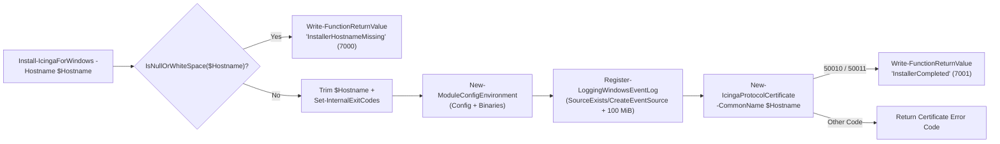

# Implementation Plan -- Base `Install-IcingaForWindows` Entrypoint & Event Log Wiring (`install-icinga-for-windows`)

## 1. Problem Statement & Objectives

Introduce the foundational public installation entrypoint for **Icinga for Windows** (`Install-IcingaForWindows`) and complete the Windows Event Log registration and `-Area` logging pipeline so initial host provisioning can be executed cleanly and extended incrementally via Pull Requests:

1. **Public `Install-IcingaForWindows` Cmdlet (`src/Core/Runtime/Public/Install-IcingaForWindows.ps1`):**
   - Provide a clean, extensible public entrypoint accepting `[string]$Hostname = $null`.
   - Intentionally omit `[Parameter(Mandatory = $true)]` on `-Hostname` so non-interactive and automated callers never hang on PowerShell's interactive parameter prompt; instead, abort deterministically via `Write-FunctionReturnValue -ReturnValue 'InstallerHostnameMissing'` (`7000`) when `-Hostname` is null, empty, or whitespace.
   - Trim `-Hostname`, initialize `Public.ReturnCodes` via `Set-InternalExitCodes`, create the base `Config` and `Binaries` directories (`New-ModuleConfigEnvironment`), register Windows Event Log sources (`Register-LoggingWindowsEventLog`), generate the initial self-signed node certificate (`New-IcingaProtocolCertificate -CommonName $Hostname`), propagate any certificate failure code, and emit `InstallerCompleted` (`7001`) on success.
2. **Dynamic `-Area` Binding & Generic Fallback (`src/Core/Logging/Private/Write-LoggingEntry.ps1`):**
   - `Write-FunctionReturnValue` (`line 73`) already passes `-Area $codeEntry.Area` dynamically to `Write-LoggingEntry`, but `Write-LoggingEntry` lacked `[string]$Area = $null` in `param ()` and read `$codeEntry.Area` via caller scope leakage.
   - Declare `[string]$Area = $null` on `Write-LoggingEntry`, invoke `Set-InternalExitCodes` unconditionally at the start of the function, normalize non-empty values via `.Trim()`, and fall back (`# TODO`) to the generic `EventLogGenericLog` area (`'Logging'`) from `Set-InternalExitCodes` (with a flat `'Logging'` guard) whenever `-Area` is omitted or blank.
3. **In-Process Event Log Registration, Daemon Safety & Local Certificate Directory Creation (`Register-LoggingWindowsEventLog.ps1`, `Start-LoggingDaemon.ps1`, `New-IcingaProtocolCertificate.ps1`):**
   - Guard `Register-LoggingWindowsEventLog` on Windows (`Protected.OSType -eq 'Windows'`), read `(Get-GlobalRuntimeVariable).Public.ReturnCodes` (populated beforehand via `Set-InternalExitCodes` by `Install-IcingaForWindows`), guarantee `IcingaForWindows::Logging` is included, deduplicate `IcingaForWindows::<Area>` source names case-insensitively (`-notcontains`), check `[System.Diagnostics.EventLog]::SourceExists($entry)` before calling `[System.Diagnostics.EventLog]::CreateEventSource($entry, $ModuleName)` directly in-process on both Windows PowerShell 5.1 and PowerShell 7+ (re-checking `SourceExists` inside `catch` so only genuine concurrent source creation is ignored while `ArgumentException` / `InvalidOperationException` / `SecurityException` registration failures emit a structured `Warning`), and dispose `EventLogConfiguration` (`IDisposable`) handles inside `finally`.
   - Guard Windows Event Log writes inside `Start-LoggingDaemon.ps1` on `OSType -eq 'Windows'`, validate `EventId` bounds (`0..65535`, defaulting out-of-range values to `15`), cap classic Event Log strings at `31839` characters, catch unregistered-source/access exceptions without crashing the daemon loop, and place all per-iteration variable nulling and `EventLog.Dispose()` inside an outer `try / finally` block (`$LogObject.Data = $null` before `$LogObject = $null`).
   - Keep `New-IcingaProtocolCertificate.ps1` focused and minimal: guard blank/whitespace `-CommonName` (`IcingaCertCommonNameMissing` `50009`), resolve `OSType` via `Get-GlobalRuntimeVariable`, dispose transient `RSA` / `X509Certificate2` instances during self-signed generation, and ensure `Get-ModuleCertificateDirectory` exists on non-Windows hosts before writing `<CommonName>.pfx`.

---

## 2. Architecture & Design Decisions



- **Runspace & Global State Safety:** All shared state access in `Install-IcingaForWindows`, `Register-LoggingWindowsEventLog`, `Write-LoggingEntry`, `Start-LoggingDaemon`, and `New-IcingaProtocolCertificate` resolves through `Get-GlobalRuntimeVariable` and avoids PowerShell class literals (`01-Instruction.md` Section 2.9).
- **Internal Return Codes (`Set-InternalExitCodes.ps1`):**
  - `InstallerHostnameMissing` (`Code = 7000`, `Severity = 'Error'`, `Area = 'Installer'`)
  - `InstallerCompleted` (`Code = 7001`, `Severity = 'Info'`, `Area = 'Installer'`)
  - Because both entries declare `'Area' = 'Installer'`, `Register-LoggingWindowsEventLog` automatically discovers and registers the `IcingaForWindows::Installer` Windows Event Log source alongside existing module areas.
- **Windows PowerShell 5.1 vs. PowerShell 7+ Event Log Registration:**
  - In PowerShell 7 on Windows, `Get-Command -Name 'New-EventLog'` resolves to an implicit `WinPSCompatSession` remoting proxy function (`CommandType: Function`). Calling `New-EventLog -ErrorAction Stop` when an Event Log source already exists throws a deserialized `RemoteException` across the remoting boundary (not `-is [System.InvalidOperationException]`), which would cause false `Warning` entries on subsequent runs and spawn an unnecessary `powershell.exe` background process.
  - Using `[System.Diagnostics.EventLog]::SourceExists($entry)` followed by `[System.Diagnostics.EventLog]::CreateEventSource($entry, $ModuleName)` runs natively in-process on both Windows PowerShell 5.1 (`.NET Framework`) and PowerShell 7+ on Windows (`System.Diagnostics.EventLog`), ensuring already-registered sources never throw on re-runs.
  - Non-Windows systems (`Protected.OSType -ne 'Windows'`) skip Windows Event Log registration cleanly and store generated PFX certificates under `Get-ModuleCertificateDirectory`.

---

## 3. Proposed Changes

### Internal Return Codes (`src/Core/ErrorHandling`)
- **[MODIFY]** `src/Core/ErrorHandling/Private/Set-InternalExitCodes.ps1` -- Register `InstallerHostnameMissing` (`7000`) and `InstallerCompleted` (`7001`) under `Area = 'Installer'`.
- **[MODIFY]** `src/Core/ErrorHandling/Private/Write-FunctionReturnValue.ps1` -- Pass `-Area $codeEntry['Area']` using strict-mode-safe hashtable indexing so return-code entries without an explicit `Area` key (such as `ConfigMissing` during initial `New-ModuleConfigEnvironment` provisioning) cleanly trigger `Write-LoggingEntry`'s `EventLogGenericLog` fallback under `Set-StrictMode -Version Latest`.

### Runtime Installation Entrypoint (`src/Core/Runtime`)
- **[NEW]** `src/Core/Runtime/Public/Install-IcingaForWindows.ps1` -- Public `Install-IcingaForWindows` cmdlet with `-Hostname` validation and trimming, `Set-InternalExitCodes`, `New-ModuleConfigEnvironment`, `Register-LoggingWindowsEventLog`, and `New-IcingaProtocolCertificate`.

### Logging & Certificate Provisioning (`src/Core/Logging`, `src/IcingaProtocol`)
- **[MODIFY]** `src/Core/Logging/Private/Register-LoggingWindowsEventLog.ps1` -- Add Windows OS guard, strict-mode-safe `$Value['Area']` indexing, blank-area filtering, `IcingaForWindows::Logging` fallback source, case-insensitive deduplication, in-process `[System.Diagnostics.EventLog]::SourceExists` / `CreateEventSource` registration, `EventLogConfiguration.Dispose()` cleanup, and permission-failure `Warning` diagnostics (with caller precondition documented in `.NOTES`).
- **[MODIFY]** `src/Core/Logging/Private/Write-LoggingEntry.ps1` -- Add `[string]$Area = $null` parameter, `.PARAMETER Area` help table, unconditional `Set-InternalExitCodes` initialization, null-safe `$Data` initialization, and strict-mode-safe `# TODO` fallback to `EventLogGenericLog` (`'Logging'`).
- **[MODIFY]** `src/Core/Logging/Private/Start-LoggingDaemon.ps1` -- Guard Windows Event Log writes on `OSType -eq 'Windows'`, resolve `Area` via `Get-ModuleObjectValue`, validate `0..65535` `EventId` bounds, truncate classic Event Log payloads at `31839` characters, catch unregistered-source exceptions, and clean up loop variables inside `try / finally` (`$LogObject.Data = $null` before `$LogObject = $null`).
- **[MODIFY]** `src/IcingaProtocol/Public/New-IcingaProtocolCertificate.ps1` -- Guard whitespace `-CommonName` and trim input, resolve `OSType` via `Get-GlobalRuntimeVariable`, dispose transient self-signed `X509Certificate2` and `RSA` handles, ensure `Get-ModuleCertificateDirectory` exists before writing PFX files on non-Windows hosts, and align `.OUTPUTS` / `.NOTES` help with `System.Int32` return codes and `Cert:\CurrentUser\My`.
- **[MODIFY]** `src/IcingaProtocol/Public/Import-IcingaCertAuthority.ps1` & `src/IcingaProtocol/Public/New-IcingaProtocolEnvironment.ps1` -- Align comment-based help (and generated `docs/Icinga.IcingaProtocol.md`) with `Cert:\LocalMachine\Root` elevation requirements, `50013`-`50019` numeric return codes, and `-DryRun` `@{ ExitCode; Output }` diff hashtables without modifying function bodies.

### Documentation, Tests, Governance & Generated Artifacts
- **[NEW]** `docs/General/Installation.md` -- Step-by-step installation, Icinga 2 CA import, `New-IcingaProtocolEnvironment` (`-DryRun` diff preview vs. `50019` persistence), `$fqdn` / `$hostname` placeholder, certificate signing, and runtime verification guide.
- **[MODIFY]** `README.md` -- Expand Architecture Overview, Quick Start & Base Setup (`Install-IcingaForWindows`, `Import-IcingaCertAuthority`, separated `-DryRun` preview vs. save call, Icinga 2 Object Name & placeholder notes), and Documentation Map.
- **[NEW]** `Tests/Install-IcingaForWindows.Tests.ps1` -- Comprehensive Pester unit and `$TestDrive` integration tests covering `Install-IcingaForWindows` (including cold-state `Public.ReturnCodes` initialization), `Set-StrictMode -Version Latest` execution, `New-IcingaProtocolCertificate` self-signed and `-SignedCert` merge paths, `Import-IcingaCertAuthority`, `New-IcingaProtocolEnvironment` (`-DryRun` vs. `50019` persistence), `Register-LoggingWindowsEventLog`, `Start-LoggingDaemon`, and `Write-LoggingEntry` `-Area` resolution.
- **[MODIFY]** `docs/General/Changelog.md` & `docs/General/Roadmap.md` -- Record feature/bugfix entries and synchronize milestone and planned backlog tracking.
- **[REGENERATE]** `lib/IcingaForWindows.{Classes,Kernel}.ps1`, `docs/Icinga.*.md`, and `docs/index.md` via `build/Build-ModuleProject.ps1` and `build/Build-ModuleDocs.ps1`.

---

## 4. Verification Plan

1. Compile artifacts, API docs, daemon memory-leak checks, and code-styling checks:
   ```powershell
   .\build\Build-ModuleProject.ps1 -SkipTests -GenerateDocs -TestDaemonMemoryLeaks -TestCodeStyling;
   ```
2. Validate strict comment-based help and SPDX compliance across all functions:
   ```powershell
   .\build\Build-ModuleDocs.ps1 -Strict $true;
   ```
3. Run changelog/roadmap governance and `PSScriptAnalyzer` gates:
   ```powershell
   .\build\Test-ModuleChangelog.ps1;
   .\build\Invoke-ScriptAnalysis.ps1 -FailOn 'Warning';
   ```
4. Execute the new installer test suite and the full repository Pester suite:
   ```powershell
   .\build\Invoke-ModuleTests.ps1 -Path .\Tests\Install-IcingaForWindows.Tests.ps1;
   .\build\Invoke-ModuleTests.ps1;
   ```
