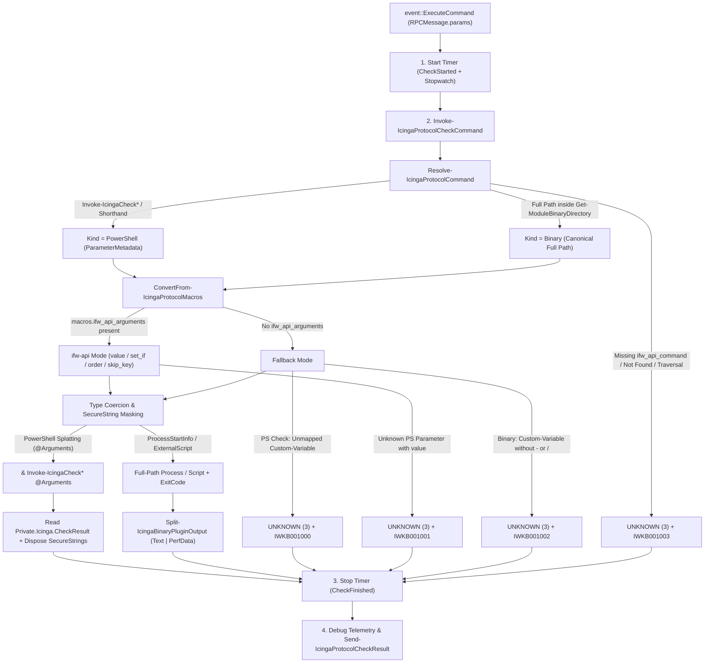

# Implementation Plan — Icinga Protocol Check-Command & Binary Execution (`plugins-cpu-service-partition`)

## 1. Problem Statement & Objectives

Prior to this implementation, `Start-IcingaProtocolWorker` handled `event::ExecuteCommand` RPC frames from Icinga 2 by invoking the bare command string without argument binding, macro resolution, `SecureString` handling, or external binary execution (`& $ExecuteCommand`). In addition, `Get-IcingaUnixTime -Milliseconds` computed timestamps against local `Get-Date '1/1/1970'`, introducing a timezone offset (for example +3600s in CET) relative to UTC `execution_start` and `execution_end` timestamps expected by Icinga 2.

This design delivers a modular, runspace-safe, and fully unit-tested command execution pipeline (without monkey-patching or `Get-Help` overhead) alongside the core monitoring plugins (`Invoke-IcingaCheckCPU`, `Invoke-IcingaCheckDirectory`, `Invoke-IcingaCheckMemory`, `Invoke-IcingaCheckPartitionSpace`, `Invoke-IcingaCheckPerfCounter`, `Invoke-IcingaCheckProcess`, `Invoke-IcingaCheckScheduledTask`, `Invoke-IcingaCheckService`, `Invoke-IcingaCheckUptime`):

1. **Dual Icinga 2 Macro Delivery Modes:**
   - **Active `ifw-api` mode (`macros.ifw_api_arguments` present):** Resolves single and embedded `$macro$` tokens, preserves case-distinct CLI flags (`-p` vs `-P`, `-c` vs `-C`), handles Icinga 2 serialized valueless flags (`"value": null` on binaries and PowerShell `[switch]` parameters), evaluates `set_if` conditions safely via `ConvertFrom-ModuleBoolean`, orders binary CLI flags via `order` (`InvariantCulture`), honors `skip_key` and `repeat_key`, skips unset/`null`/empty `""` optional template placeholders, and rejects non-empty unknown PowerShell parameters with `[UNKNOWN]` (`3`) and `IWKB001001`.
   - **Fallback mode (`macros.ifw_api_arguments` absent):** Ignores empty `""` placeholder keys alongside `ifw_api_*` and `IcingaPowerShellBase_*` transport macros, maps PowerShell check parameters by exact parameter/alias name or the standard `IcingaCheck<Name>_<DataType>_<ParameterName>` convention (returning `[UNKNOWN]` `3` with `IWKB001000` on unmapped custom variables), and restricts binary fallback variables to `-` or `/` prefixed flags (`IWKB001002` otherwise).
2. **Mandatory `ifw_api_command`, NTFS ADS Protection & Shorthand Expansion:**
   - Enforces `macros.ifw_api_command` on every check invocation instead of guessing from `params.command` (returning `[UNKNOWN]` + `IWKB001003` for unmodified ITL checks such as `load-windows`).
   - Rejects ASCII control characters (`0x00..0x1F`), drive-relative paths (`C:evil.exe`), and NTFS Alternate Data Streams (`check_load.exe:stream`).
   - Supports shorthand names such as `"cpu"` -> `Invoke-IcingaCheckCPU` when no matching file exists inside `Get-ModuleBinaryDirectory()`.
3. **PowerShell vs. Native Binary Execution & Timeout Split:**
   - Restricts external executables and scripts (`.exe`, `.cmd`, `.bat`, `.com`, `.ps1`) exclusively to `Get-ModuleBinaryDirectory()` (`C:\ProgramData\IcingaForWindows\Binaries`), rejecting path traversal or external paths with `IWKB001003` and never consulting `$env:PATH`.
   - Executes PowerShell check plugins (`Invoke-IcingaCheck*`) and external `.ps1` scripts in-process via `&` (never dot-sourced) with no custom timeout wrapper (relying on `Start-ThreadHouseKeeper`), supporting `New-IcingaPlugin` `.Compile()` results and `[securestring]` masking in `CommandLine`.
   - Executes non-PowerShell binaries (`.exe`, `.cmd`, `.bat`, `.com`) via `System.Diagnostics.Process` with `CommandLineToArgvW` quoting, `.cmd`/`.bat` `cmd.exe` metacharacter validation, asynchronous stdout/stderr reads (`stderr` fallback when `stdout` is blank), `params.check_timeout` enforcement with full descendant process-tree termination (`Win32_Process` on Windows, `Kill($true)` + `pgrep -P` on Unix) and handle `WaitForExit` rundown, Nagios/Icinga `|` perfdata splitting (including scoped `pkg::'Label'=val` and doubled quotes), and exit-code normalization to `0..3`.
4. **`SecureString` Conversion, Masking & Deterministic Disposal:**
   - Converts plain-text secret macros into read-only `[System.Security.SecureString]` instances via direct `AppendChar` + `MakeReadOnly` (avoiding `ConvertTo-SecureString -AsPlainText` analyzer errors and empty-string binding errors on Windows PowerShell 5.1), masks values as `'********'` in `cr.command` and logs across both plugins and external `.ps1` scripts, and disposes allocated `SecureString` instances in `finally`.
5. **Monotonic Execution Timing & Host/Service Dispatch:**
   - Measures the full local check lifecycle (`Stopwatch` started before command resolution and macro evaluation, stopped immediately after check execution before logging and JSON-RPC transmission) and omits `'service'` on `event::CheckResult` when `params.service` is empty so Icinga 2 processes Host checks cleanly.

---

## 2. Architecture & Design Decisions

### 2.1 Runspace & Threading Model

- All worker and check helpers access runtime state exclusively via `Get-GlobalRuntimeVariable` so thread-local `Private.Icinga.CheckResult` and `Protected.IsBackgroundDaemon` resolve to the active worker runspace.
- No PowerShell class literals from `src/Classes` are used inside any function (`Tests/ClassLiteral.Tests.ps1`); `Invoke-IcingaProtocolCheckCommand` returns a plain `[hashtable]` (`ExitCode`, `Output`, `PerformanceData`, `CommandLine`) so no `IcingaCheckResult` instance crosses thread boundaries.
- All local reference variables inside `Start-IcingaProtocolWorker`'s `while (Test-ThreadRunning -NoSleep)` loop are explicitly reset to `$null` in `finally` (`build/Test-ModuleDaemonMemoryLeak.ps1`).
- Deserialized JSON structures from `ConvertFrom-ModuleJson` are accessed through `[System.Collections.IDictionary]` normalization so both Windows PowerShell 5.1 (`Dictionary[string, object]`) and PowerShell 7+ (`Hashtable`) behave identically.

### 2.2 Execution Data Flow

### 2.3 Internal Exit Codes & Knowledgebase IDs

| Internal Key | Code | Severity | User-Facing `IWKB` |
|--------------|------|----------|--------------------|
| `SecureStringConversionFailed` | `4004` | `Error` | — |
| `IcingaProtocolCommandMissing` | `50020` | `Error` | `IWKB001003` |
| `IcingaProtocolCommandNotFound` | `50021` | `Error` | `IWKB001003` |
| `IcingaProtocolBinaryPathRejected` | `50022` | `Error` | `IWKB001003` |
| `IcingaProtocolMacroMappingFailed` | `50023` | `Error` | `IWKB001000` / `IWKB001002` |
| `IcingaProtocolUnknownParameter` | `50024` | `Error` | `IWKB001001` |
| `IcingaProtocolCheckExecuted` | `50025` | `Debug` | — |

---

## 3. Proposed File Changes

### Environment, Security, Converters & Return Codes
- **[MODIFY]** `IcingaForWindows.psm1` — Add `Get-ModuleBinaryDirectory()`.
- **[MODIFY]** `src/Config/Private/New-ModuleConfigEnvironment.ps1` — Ensure `Get-ModuleBinaryDirectory()` is created automatically during environment initialization.
- **[MODIFY]** `src/Security/Private/Get-SecureChildItem.ps1` — Include `(Get-ModuleBinaryDirectory)` in `$ApprovedPathList`.
- **[MODIFY]** `src/Tools/Public/Get-IcingaUnixTime.ps1` — Use `[System.DateTimeOffset]::UtcNow` for UTC-exact integer and fractional millisecond timestamps.
- **[NEW]** `src/Tools/Private/ConvertTo-ModuleSecureString.ps1` — Safe `SecureString` converter across PS 5.1 and PS 7+.
- **[NEW]** `src/Tools/Private/ConvertFrom-ModuleBoolean.ps1` — Deterministic boolean converter for macro/JSON values.
- **[MODIFY]** `src/Core/ErrorHandling/Private/Set-InternalExitCodes.ps1` — Register `50020`–`50025` `IcingaProtocol` return codes.

### IcingaProtocol Check Execution Pipeline
- **[NEW]** `src/IcingaProtocol/Private/Resolve-IcingaProtocolCommand.ps1` — Strict `ifw_api_command` resolution, shorthand expansion, and `Binaries` path validation.
- **[NEW]** `src/IcingaProtocol/Private/ConvertFrom-IcingaProtocolMacros.ps1` — `ifw-api` and fallback macro parser, type coercion, `SecureString` masking, and `cr.command` rendering.
- **[NEW]** `src/IcingaProtocol/Private/Split-IcingaBinaryPluginOutput.ps1` — Nagios/Icinga `|` stdout and performance-data parser.
- **[NEW]** `src/IcingaProtocol/Private/Invoke-IcingaProtocolCheckCommand.ps1` — End-to-end check and binary execution orchestrator.
- **[MODIFY]** `src/IcingaProtocol/Private/Start-IcingaProtocolWorker.ps1` — Integrate monotonic execution timing, `Invoke-IcingaProtocolCheckCommand`, and dictionary-safe RPC handling.

### Documentation & Automated Tests
- **[NEW]** `docs/Developer/IcingaProtocol/01-Check-and-Binary-Execution.md`
- **[NEW]** `docs/Knowledgebase/index.md`
- **[NEW]** `docs/Knowledgebase/IWKB001000.md` .. `IWKB001003.md`
- **[NEW]** `Tests/ConvertTo-ModuleSecureString.Tests.ps1`
- **[NEW]** `Tests/ConvertFrom-ModuleBoolean.Tests.ps1`
- **[NEW]** `Tests/Resolve-IcingaProtocolCommand.Tests.ps1`
- **[NEW]** `Tests/ConvertFrom-IcingaProtocolMacros.Tests.ps1`
- **[NEW]** `Tests/Invoke-IcingaProtocolCheckCommand.Tests.ps1`

---

## 4. Verification Plan

1. Compile `lib/` and regenerate API docs with strict validation (`.\build\Build-ModuleProject.ps1 -SkipTests`, `.\build\Build-ModuleDocs.ps1`).
2. Validate code styling (`.\build\Test-ModuleCodeStyling.ps1`), class literal isolation (`Tests/ClassLiteral.Tests.ps1`), and daemon memory safety (`.\build\Test-ModuleDaemonMemoryLeak.ps1`).
3. Run all new and existing Pester unit test suites.
4. Verify live Icinga 2 agent execution on Windows against `ifw-api` active/inactive service checks and external binaries in `C:\ProgramData\IcingaForWindows\Binaries`.
