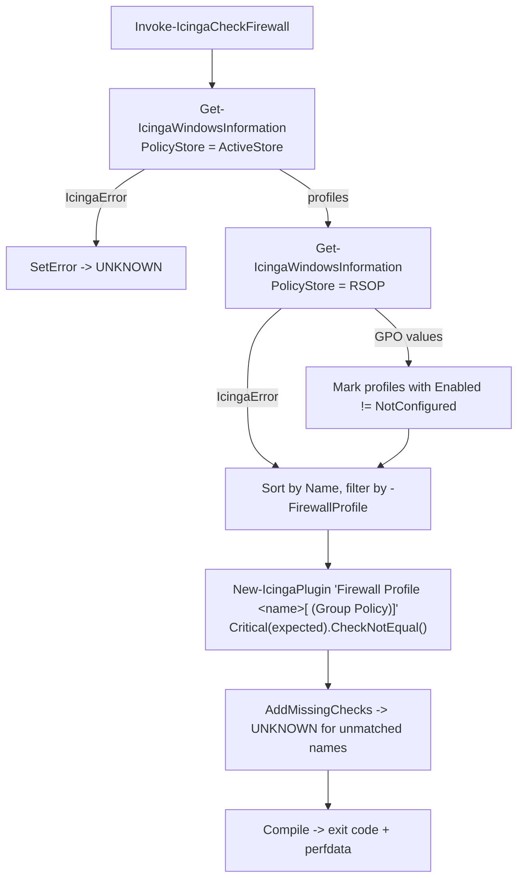

# Implementation Plan -- `plugins-firewall`

## Problem Statement & Objectives

The legacy `icinga-powershell-plugins` repository ships `Invoke-IcingaCheckFirewall`, which reports whether the Windows Firewall profiles (Domain, Private, Public) are enabled or disabled. **Icinga for Windows** has no equivalent yet; the check is listed under "Remaining Core Windows Monitoring Plugins" in the [Roadmap](../../../General/Roadmap.md).

Objectives:

* Port the check onto the `New-IcingaPlugin` SDK and the current house style (one function per file, comment-based help with `.PARAMETER` tables, SPDX `.NOTES`).
* Keep existing Icinga 2 command definitions working: same parameter names (`-FirewallProfile`, alias `-Profile`) and the same `-Enabled` semantics.
* Keep the functional scope 1:1 (enabled / disabled per profile only). Default inbound / outbound actions are out of scope.
* **Evaluate the effective state including Active Directory Group Policies.** The legacy check read only the local store, so a profile enforced (or disabled) by a GPO was reported wrongly (maintainer request after the first port).

## Legacy Behavior (Reference)

Source: `analyze/icinga-powershell-plugins/plugins/Invoke-IcingaCheckFirewall.psm1` (local reference clone, not tracked).

* Calls `Get-NetFirewallProfile -Name <profile> -ErrorAction SilentlyContinue` per requested profile, which reads the local `PersistentStore` and ignores Group Policy.
* `-Enabled` is a switch: set means "must be enabled", absent means "must be disabled".
* Without `-FirewallProfile` nothing is checked.
* A missing profile becomes UNKNOWN through `-ObjectExists`.
* Perfdata: `'firewall_profile_domain'=True`.

## Design Decisions

| Topic | Decision | Rationale |
| ----- | -------- | --------- |
| Policy store | `ActiveStore` (effective state) | Merges local settings with every applied GPO; this is what Windows actually enforces. No parameter to fall back to the local store (not needed so far). |
| Group Policy marker | Second query against the `RSOP` store; profiles with a GPO value other than `NotConfigured` get ` (Group Policy)` appended to the check name | Admins see immediately that the state is enforced centrally. A failed RSOP query only drops the marker, it never fails the check. |
| Store access | New optional `-OperationOption` hashtable on `Get-IcingaWindowsInformation` | `Get-CimInstance` cannot pass provider custom options (`PolicyStore`). The shared helper keeps structured `IcingaError` failures and return codes and is reusable for further NetSecurity classes (for example firewall rules). |
| `-OperationOption` mechanics | Local `New-CimSession`, `CimOperationOptions.SetCustomOption(...)`, WQL `SELECT <Property> FROM <Class> [WHERE <Filter>]` via `QueryInstances`; session and options disposed in `finally` | Same `-Filter` / `-Property` semantics as the `Get-CimInstance` path. Verified on Windows PowerShell 5.1 and PowerShell 7. |
| Error mapping | Unwrap `InnerException` until an exception with `NativeErrorCode` is found | Method calls on a `CimSession` wrap the `CimException` into a `RuntimeException`; unwrapping keeps the existing `WindowsInformation*` codes. |
| `-Enabled` | Kept as `[switch]`, absent = expect disabled | Backwards compatible with existing command definitions. |
| Empty `-FirewallProfile` | Check all profiles of the host | The legacy "check nothing and return OK" result hid misconfiguration. |
| Unknown profile name | `AddMissingChecks(..., 'Unknown')` | Matches the service plugin pattern; wildcards that select nothing are reported too. |
| Value & output | Raw GpoBoolean (`0`, `1`, `2`) with `Translate(@{ 0 = 'Disabled'; 1 = 'Enabled'; 2 = 'NotConfigured' })` | Numeric, graphable perfdata with readable output; `NotConfigured` never equals the expected state. |
| Perfdata | `<profile>::ifw_firewall::enabled` | Same schema as every other ported plugin (`<index>::ifw_<plugin>::<label>`); the GPO marker only changes the check name, not the metric index. |

### Runspace & Threading

* No class literals: the plugin uses `New-IcingaPlugin` and `Test-IcingaError`; `Get-IcingaWindowsInformation` resolves `IcingaError` through `'IcingaError' -as [type]` (`Tests/ClassLiteral.Tests.ps1`).
* `CimSession` and `CimOperationOptions` are `IDisposable` and disposed in `finally`, so daemon threads calling the plugin do not leak handles.

### Return Codes

No new codes. Query failures reuse the `WindowsInformation*` codes of `Get-IcingaWindowsInformation`; the error data now also carries `OperationOption`.

## Proposed Changes

* `[NEW]` `src/Plugins/Checks/Public/Invoke-IcingaCheckFirewall.ps1`
* `[MODIFY]` `src/Tools/Public/Get-IcingaWindowsInformation.ps1` -- `-OperationOption`, CimSession path, exception unwrapping
* `[NEW]` `Tests/Invoke-IcingaCheckFirewall.Tests.ps1`
* `[MODIFY]` `Tests/Get-IcingaWindowsInformation.Tests.ps1` -- CimSession path tests
* `[MODIFY]` `docs/General/Changelog.md`, `docs/General/Roadmap.md`
* `[MODIFY]` `docs/Icinga.Plugins.Checks.md`, `docs/Icinga.Tools.md`, `docs/index.md` -- regenerated by `build/Build-ModuleDocs.ps1`

## Data Flow



## Verification Plan

```powershell
.\build\Build-ModuleProject.ps1 -SkipTests;
.\build\Test-ModuleCodeStyling.ps1;
.\build\Test-ModuleChangelog.ps1;
.\build\Invoke-ScriptAnalysis.ps1 -FailOn 'Warning';
.\build\Test-ModuleDaemonMemoryLeak.ps1;
.\build\Build-ModuleDocs.ps1 -Strict $true;
.\build\Invoke-ModuleTests.ps1;
```

Manual: `Invoke-IcingaCheckFirewall -Enabled -Verbosity 2` on a Windows 11 host (Windows PowerShell 5.1 and PowerShell 7), plus a domain-joined host with a firewall GPO for the `(Group Policy)` marker.
