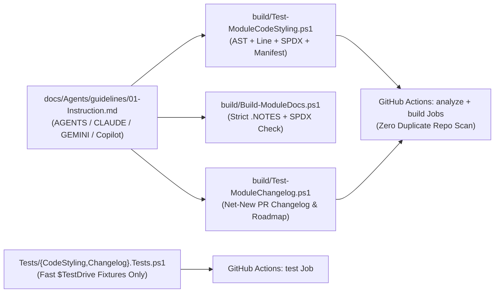

# Implementation Plan -- Holistic Code-Styling, SPDX Licensing, Documentation & Governance (`update-code-styling`)

## 1. Problem Statement & Objectives

Deliver a single, unified repository governance milestone on `feature/update-code-styling` that brings **100% of PowerShell files, documentation, compiled build artifacts, and CI gates** in **Icinga for Windows** under one binding standard without altering runtime behavior:

1. **Zero-Exemption Code-Styling Compliance (`255+` PowerShell files):**
   Remediate all `506` formatting/alignment/em-dash deviations across `src/` (`208` files), `20` deviations in `build/`, and `3` deviations in `Tests/` without exemptions or path allowlists. Enforce single-function / no-nested-function rules strictly under `src/` while permitting helper and nested functions in `build/`, `IcingaForWindows.psm1`, and `Tests/`.
2. **Mandatory `.NOTES` & Icinga GmbH SPDX License Headers (`GPL-3.0-or-later`):**
   Require `.NOTES` concluding with the two Icinga GmbH SPDX lines (`SPDX-FileCopyrightText: 2026 Icinga GmbH <https://icinga.com>` and `SPDX-License-Identifier: GPL-3.0-or-later`) across every file in `src/` (`Public/`, `Private/`, and `Classes/`), in `IcingaForWindows.psm1`, in every `build/*.ps1` script, and in every `Tests/*.Tests.ps1` file; emit `# SPDX-...` comments at the top of compiled `lib/IcingaForWindows.{Classes,Kernel}.ps1` artifacts (written as BOM-less UTF-8); and update `IcingaForWindows.psd1` from `MIT` to `GPL-3.0-or-later` (`blob/main/LICENSE` + `PrivateData.SPDX` with `# SPDX-...` comments).
3. **`docs/General/Changelog.md` & `docs/General/Roadmap.md` Governance:**
   Introduce `docs/General/Changelog.md` and `docs/General/Roadmap.md` modeled on the Icinga documentation structure, enforce via `build/Test-ModuleChangelog.ps1` that every non-`main` branch / Pull Request adds a changelog bullet entry, and require `Roadmap.md` synchronization whenever plans under `docs/Agents/tasks/<BranchSlug>/` are created or completed.
4. **Single-Run CI Integration Alongside `PSScriptAnalyzer` (No Duplicate Scans):**
   Wire `build/Test-ModuleCodeStyling.ps1` and `build/Test-ModuleChangelog.ps1` into the `analyze` job of `.github/workflows/ci.yml` alongside `build/Invoke-ScriptAnalysis.ps1` (`fetch-depth: 0`), while keeping `Tests/CodeStyling.Tests.ps1` and `Tests/Changelog.Tests.ps1` strictly to fast `$TestDrive` unit tests so `Invoke-ModuleTests.ps1` never scans the repository tree a second time.
5. **`README.md` Overhaul & Strict `"Icinga for Windows"` Prose Naming:**
   Rewrite `README.md` in clear English with Mermaid runtime and CI governance diagrams, and enforce across all prose documentation and help comments that **"Icinga for Windows"** is used in text while **`IcingaForWindows`** is reserved exclusively for technical module, path, file, and `$Global:IcingaForWindows` identifiers.

---

## 2. Architecture & Design Decisions

- **Zero Runtime Logic Impact:** All `src/` edits are strictly comment/help additions, Unicode dash replacements inside comments, `.PARAMETER` Markdown pipe alignments, and horizontal `=` / indentation whitespace alignments. Non-comment, non-newline PowerShell AST token streams across all `208` `src/*.ps1` files are verified to match `main` (`3f7fa6e`) 100%.
- **Windows PowerShell 5.1 BOM Safety:** `build/Build-ModuleProject.ps1` writes `lib/IcingaForWindows.Classes.ps1` and `lib/IcingaForWindows.Kernel.ps1` via `[System.IO.File]::WriteAllText(..., [System.Text.UTF8Encoding]::new($false))` rather than `Set-Content -Encoding UTF8` (which emits a 3-byte BOM on Windows PowerShell 5.1).
- **Clean API Reference Output:** `build/Build-ModuleDocs.ps1` validates `.NOTES` + SPDX presence on both `Public` and `Private` functions, strips machine-readable `SPDX-...` lines from rendered `#### Notes` Markdown sections, and restricts cleanup in `docs/` to `Icinga.*.md` and `index.md`.

---

## 3. Proposed File Changes

### Governance & Agent Entrypoints
- **[MODIFY]** `docs/Agents/guidelines/01-Instruction.md`, `CLAUDE.md`, `AGENTS.md`, `GEMINI.md`, `.github/copilot-instructions.md`
- **[NEW]** `docs/General/Changelog.md`
- **[NEW]** `docs/General/Roadmap.md`
- **[MODIFY]** `README.md`, `docs/Developer/Plugins/04-Custom-Plugin-Developer-Guide.md`, `docs/Developer/Threading/01-Threading.md`

### Manifest, Bootstrap & Build Tooling
- **[MODIFY]** `IcingaForWindows.psd1`
- **[MODIFY]** `IcingaForWindows.psm1`
- **[MODIFY]** `PSScriptAnalyzerSettings.psd1`
- **[MODIFY]** `build/Build-ModuleProject.ps1`
- **[MODIFY]** `build/Build-ModuleDocs.ps1`
- **[MODIFY]** `build/Invoke-ModuleTests.ps1`
- **[MODIFY]** `build/Invoke-ScriptAnalysis.ps1`
- **[MODIFY]** `build/Test-ModuleDaemonMemoryLeak.ps1`
- **[NEW]** `build/Test-ModuleCodeStyling.ps1`
- **[NEW]** `build/Test-ModuleChangelog.ps1`
- **[MODIFY]** `.github/workflows/ci.yml`

### Full Source & Test Formatting + SPDX Remediation
- **[MODIFY]** `src/**/*.ps1` (`208` files: formatting alignment + `.NOTES` + SPDX headers; zero AST code token changes)
- **[MODIFY]** `Tests/*.Tests.ps1` (`36` existing test files + `[NEW]` `Tests/CodeStyling.Tests.ps1` + `[NEW]` `Tests/Changelog.Tests.ps1`)
- **[REGENERATE]** `docs/Icinga.*.md` & `docs/index.md` (`20` auto-generated API reference files)

---

## 4. Verification Plan

1. Verify zero AST non-comment/non-newline token differences across all `208` `src/*.ps1` files compared to `main` (`3f7fa6e`).
2. Run `.\build\Build-ModuleProject.ps1 -SkipTests -TestDaemonMemoryLeaks` and verify BOM-less UTF-8 + top SPDX headers in `lib/IcingaForWindows.{Classes,Kernel}.ps1` and `Test-ModuleManifest -Path .\IcingaForWindows.psd1`.
3. Run `.\build\Build-ModuleDocs.ps1 -Strict $true` (`0` violations across `198` functions).
4. Run `.\build\Test-ModuleCodeStyling.ps1` (`0` violations across `src/`, `build/`, `Tests/`, `IcingaForWindows.psm1`, `IcingaForWindows.psd1`, and `lib/`).
5. Run `.\build\Test-ModuleChangelog.ps1` and `.\build\Invoke-ScriptAnalysis.ps1 -FailOn 'Warning'` (`0` violations).
6. Run `.\build\Invoke-ModuleTests.ps1` and validate all relative Markdown links across `31` hand-written Markdown files.
