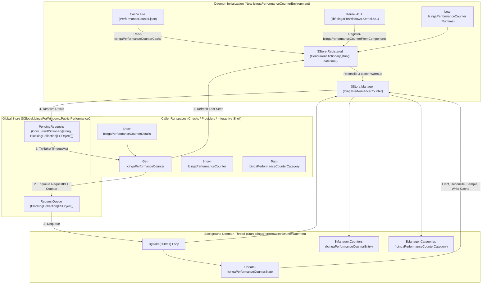

# Performance Counter Technical Architecture and Reference

The Icinga for Windows Performance Counter subsystem provides a thread-safe, zero-configuration, low-latency abstraction over `.NET` Windows Performance Counters (`System.Diagnostics.PerformanceCounter` and `System.Diagnostics.PerformanceCounterCategory`).

It is designed around four core architectural principles:

1. **Single-Thread Handle Ownership:** `.NET` performance counter instances are not thread-safe. When the background daemon is running, all counter handles and category snapshots are owned, sampled, reconciled, and disposed exclusively by the dedicated daemon thread. Callers across any number of worker threads communicate with the daemon strictly via lock-free concurrent queues.
2. **Two-Tier Sampling Strategy:**
   - **Concrete Counter Paths** (`\Category\Counter` or `\Category(Instance)\Counter`) are backed by persistent `System.Diagnostics.PerformanceCounter` handles (`IcingaPerformanceCounterEntry`).
   - **Wildcard Counter Paths** (`\Category(*)\Counter`) are backed by category-level bulk snapshots (`IcingaPerformanceCounterCategory` wrapping `PerformanceCounterCategory.ReadCategory()`). Instead of allocating and warming dozens or hundreds of individual handles per process or disk, a single kernel transition captures the entire category table and computes cooked values across consecutive `InstanceDataCollectionCollection` snapshots using `CounterSample.Calculate`.
3. **Proactive Warm-Up via Static AST Discovery and Persistent Caching:** Rate-based counters (such as `% Processor Time` or `Disk Reads/sec`) require two samples separated by a time delta (`WarmupMilliseconds`, default `250 ms`) to produce a meaningful non-zero value. To eliminate this delay during check execution, the subsystem discovers statically declared counters from `lib\IcingaForWindows.Kernel.ps1` via PowerShell AST parsing at startup and merges them with the self-maintaining `PerformanceCounter.json` cache file. All known counters are warmed in a single shared batch before the first check runs.
4. **Windows PowerShell 5.1 Runspace Isolation:** PowerShell classes carry runspace affinity to the `SessionStateInternal` in which their scriptblock was compiled. Calling a method on a class instance created from another runspace's type object marshals execution back to the origin runspace, which deadlocks when the origin runspace is blocked waiting on a daemon queue response. The subsystem compiles class definitions into a dedicated `lib\IcingaForWindows.Classes.ps1` file loaded with a unique scriptblock cachebuster per runspace on Windows PowerShell 5.1 (`Desktop` edition) and resolves all class types dynamically via `'ClassName' -as [type]`.

---

## 1. High-Level Architecture

---

## 2. Global Runtime State

The global state is initialized in [`IcingaForWindows.psm1`](../../../IcingaForWindows.psm1) inside `New-ModuleBaseEnvironment` at `$Global:IcingaForWindows.Public.PerformanceCounter` (accessed via `(Get-GlobalRuntimeVariable).Public.PerformanceCounter`):

| Property | Type | Initial Value | Description |
| :--- | :--- | :--- | :--- |
| `RequestQueue` | `System.Collections.Concurrent.BlockingCollection[PSObject]` | Empty queue backed by `ConcurrentQueue[PSObject]` | FIFO queue through which callers submit counter read requests (`[PSCustomObject]@{ RequestId = [string]; Counter = [string[]] }`) to the daemon thread. |
| `PendingRequests` | `System.Collections.Concurrent.ConcurrentDictionary[string, System.Collections.Concurrent.BlockingCollection[PSObject]]` | Empty dictionary | Maps each in-flight `RequestId` (GUID string) to a single-slot (`BoundedCapacity = 1`) `BlockingCollection[PSObject]` created by the caller to receive its response. |
| `Registered` | `System.Collections.Concurrent.ConcurrentDictionary[string, datetime]` | Empty dictionary | Maps each registered counter path to its last-seen `[datetime]` timestamp. Updated by `New-IcingaPerformanceCounter`, `Get-IcingaPerformanceCounter`, `Read-IcingaPerformanceCounterCache`, and `Register-IcingaPerformanceCounterFromComponents`. |
| `Manager` | `object` (`IcingaPerformanceCounter`) | `$null` | The central manager instance created lazily inside `New-IcingaPerformanceCounterEnvironment` on the daemon thread. Never accessed directly by non-daemon threads. |
| `Heartbeat` | `System.Nullable[datetime]` (`$null` or `[datetime]`) | `$null` | Timestamp updated by `New-IcingaPerformanceCounterEnvironment` and on every iteration of `Update-IcingaPerformanceCounterState`. Used by `Test-IcingaPerformanceCounterDaemon` to determine whether the daemon is alive. |
| `LastRefresh` | `System.Nullable[datetime]` (`$null` or `[datetime]`) | `$null` | Timestamp of the last heavy maintenance pass (`Reconcile`, `Sample`, cache write) inside `Update-IcingaPerformanceCounterState`. |
| `Config` | `PSCustomObject` | See table below | Tunable timing and eviction parameters for the subsystem. |

### Configuration Parameters (`$Store.Config`)

| Setting | Type | Default | Description |
| :--- | :--- | :--- | :--- |
| `WarmupMilliseconds` | `System.Int32` | `250` | Delay in milliseconds waited once after priming one or more newly added counters or category snapshots before taking the second sample, and minimum age before a wildcard category snapshot is refreshed during `Resolve()`. |
| `RefreshIntervalMs` | `System.Int32` | `1000` | Minimum interval in milliseconds between heavy daemon maintenance runs (eviction, reconciliation, background sampling, and cache file writes) in `Update-IcingaPerformanceCounterState`. |
| `EvictionMinutes` | `System.Int32` | `60` | Time window in minutes after which a registered counter path that has not been requested or refreshed is evicted from `$Store.Registered` and disposed by the manager. |

---

## 3. Execution Modes

When `Get-IcingaPerformanceCounter` is called, it selects one of three execution paths depending on the runtime environment state:

### Mode 1: Daemon Queue Dispatch (Primary Production Mode)
Used when `$Store` exists and `Test-IcingaPerformanceCounterDaemon` returns `$true` (meaning `$Store.Heartbeat` is non-null and not older than **5 seconds**).

1. Each requested path in `-Counter` has its timestamp updated in `$Store.Registered[$Path] = (Get-Date)`.
2. A unique `[string]$RequestId = (New-Guid).ToString()` is generated.
3. A bounded single-item response queue (`[System.Collections.Concurrent.BlockingCollection[PSObject]]::new(1)`) is registered at `$Store.PendingRequests[$RequestId]`.
4. The request payload (`[PSCustomObject]@{ RequestId = $RequestId; Counter = [string[]]$Counter }`) is added to `$Store.RequestQueue`.
5. The caller blocks on `$ResponseQueue.TryTake([ref]$Response, $TimeoutMs)` (default `5000 ms`).
6. If the daemon responds in time, `$Response` is returned (and optionally reshaped if `-StructureByInstance` is set). If `TryTake` times out, a `Warning` entry (`Get-IcingaPerformanceCounter: Request timed out`) is written via `Write-LoggingEntry` and `$null` is returned.
7. A `finally` block always removes `$RequestId` from `$Store.PendingRequests` and disposes `$ResponseQueue`.

### Mode 2: Persistent Per-Runspace Inline Fallback
Used when `$Store` is initialized (`Use-IcingaForWindows` has run), but the background daemon is not running or its heartbeat is older than 5 seconds (for example in interactive CLI sessions started without `-RunBackgroundDaemons`).

1. Each requested path is recorded in `$Store.Registered[$Path] = (Get-Date)`.
2. The function lazily initializes a module-scoped manager instance `$script:IcingaPerformanceCounterInlineManager = ('IcingaPerformanceCounter' -as [type])::new()`.
3. Because each PowerShell runspace has its own isolated `$script:` module scope and executes one pipeline at a time, `$script:IcingaPerformanceCounterInlineManager` is never accessed concurrently and requires no locking.
4. Counter handles and category snapshots remain warm in `$script:IcingaPerformanceCounterInlineManager` across repeated calls within that runspace; only the first read of a newly requested counter pays the `WarmupMilliseconds` sleep.

### Mode 3: Transient One-Shot Read (`ResolveOnce`)
Used when `$Store` is `$null` (the global runtime variable has not been initialized at all).

1. Calls `('IcingaPerformanceCounter' -as [type])::ResolveOnce([string[]]$Counter, 250)`.
2. Creates a temporary `IcingaPerformanceCounter` instance, primes all requested paths, sleeps `250 ms` once, reads the counters, and disposes all handles immediately in a `finally` block.

---

## 4. Startup Discovery, Cache Persistence, and Maintenance Lifecycle

### 4.1 Environment Initialization (`New-IcingaPerformanceCounterEnvironment`)
Executed once at the start of `Start-IcingaPerformanceCounterDaemon`:

1. Instantiates `$Store.Manager = ('IcingaPerformanceCounter' -as [type])::new()` and copies `$Store.Config.WarmupMilliseconds` to `$Store.Manager.WarmupMilliseconds`.
2. Calls `Read-IcingaPerformanceCounterCache` to load previously persisted counter paths and timestamps from `<ModuleCacheDirectory>\PerformanceCounter.json` into `$Store.Registered`. Missing, empty, or corrupt JSON files are silently ignored so a damaged cache never blocks startup.
3. Calls `Register-IcingaPerformanceCounterFromComponents` to statically scan `lib\IcingaForWindows.Kernel.ps1` using `[System.Management.Automation.Language.Parser]::ParseFile(...)`. Every `CommandAst` calling `New-IcingaPerformanceCounter` is inspected, and all `StringConstantExpressionAst` literals passed to `-Counter` (both `-Counter @(...)` and `-Counter:@(...)`) are extracted via `Get-IcingaPerformanceCounterLiteral` and added to `$Store.Registered` without executing any component code.
4. Calls `$Store.Manager.Reconcile(@($Store.Registered.Keys))`, which primes all discovered concrete counters and wildcard categories and sleeps **once** (`WarmupMilliseconds`) for the entire startup batch.
5. Sets `$Store.Heartbeat = (Get-Date)` and `$Store.LastRefresh = (Get-Date)` and logs an `Info` message (`Performance counter environment initialized`).

### 4.2 Periodic Maintenance (`Update-IcingaPerformanceCounterState`)
Called on every cycle of `Start-IcingaPerformanceCounterDaemon` (after `RequestQueue.TryTake([ref]$Request, 500)`):

1. **Heartbeat Refresh (Every Cycle):** Updates `$Store.Heartbeat = (Get-Date)` unconditionally so `Test-IcingaPerformanceCounterDaemon` remains accurate even when the daemon is busy serving requests.
2. **Throttling Check:** If `$Store.LastRefresh` is less than `$Store.Config.RefreshIntervalMs` (`1000 ms`) ago, returns immediately.
3. **Eviction:** Computes `$Threshold = (Get-Date).AddMinutes(-1 * $Store.Config.EvictionMinutes)`. Any key in `$Store.Registered` whose last-seen timestamp is older than `$Threshold` is removed via `$Store.Registered.TryRemove($Key, [ref]$Removed)`.
4. **Reconciliation (`$Manager.Reconcile($Registered)`):**
   - Primes any newly registered concrete paths or wildcard categories in a single batch.
   - Disposes and removes any concrete counter handles or category snapshots that are no longer in `$Registered`.
5. **Background Sampling (`$Manager.Sample()`):**
   - Calls `$Entry.Handle.NextValue()` on every concrete counter entry and `$Snapshot.Refresh()` on every category snapshot so rate counters continuously track recent activity between check invocations.
6. **Atomic Cache Persistence (`Write-IcingaPerformanceCounterCache`):**
   - Serializes `$Store.Registered` (with ISO 8601 round-trip `'o'` timestamps) to `<ModuleCacheDirectory>\PerformanceCounter.json.tmp` (`UTF8`) and atomically renames it over `PerformanceCounter.json` via `Move-Item -Force`.
7. **Timestamp Update:** Sets `$Store.LastRefresh = (Get-Date)`.

---

## 5. Path Parsing, Normalization, and Local Host Handling

`IcingaPerformanceCounter::ParsePath([string]$Path)` and `IcingaPerformanceCounter::NormalizePath([string]$Path)` enforce a strict canonical path grammar:

- **Accepted Machine Prefixes (Local Host Only):**
  - Machine-less paths starting with a single backslash: `\Category\Counter` or `\Category(Instance)\Counter`
  - Local machine prefixes starting with `\\`:
    - `\\.\Category\Counter`
    - `\\localhost\Category\Counter` (case-insensitive)
    - `\\127.0.0.1\Category\Counter`
    - `\\::1\Category\Counter`
    - `\\<Environment.MachineName>\Category\Counter` (case-insensitive match against `[System.Environment]::MachineName`)
- **Rejected Paths (`Valid = $false`):**
  - Null, empty, or paths not starting with `\`
  - Remote machine paths (`\\remote-host\Category\Counter`)
  - Paths that do not split into exactly three segments (`''`, `<CategorySegment>`, `<CounterName>`)
  - Empty category or counter names
  - Malformed instance parentheses (such as `Category(Instance` without closing `)`, trailing characters after `)`, empty category before `(`, or empty instance name `Category()`)
- **Canonical Normalization (`NormalizePath`):**
  - Strips any valid local machine prefix so that `\\.\Memory\Available Bytes`, `\\localhost\Memory\Available Bytes`, and `\Memory\Available Bytes` all normalize to `\Memory\Available Bytes`.
  - Internally, `IcingaPerformanceCounter` normalizes concrete counter paths in `CreateEntry`, `Warmup`, `ReadPath`, `Resolve`, and `Reconcile` so a counter requested under both `\Memory\Available Bytes` and `\\.\Memory\Available Bytes` shares a single underlying `IcingaPerformanceCounterEntry` handle while `Resolve()` still keys its outer return hashtable by the exact path string requested by the caller.

---

## 6. Class Reference (`src/Classes/Icinga/IcingaPerformanceCounter.ps1`)

All three classes are defined in [`src/Classes/Icinga/IcingaPerformanceCounter.ps1`](../../../src/Classes/Icinga/IcingaPerformanceCounter.ps1).

### 6.1 Class `IcingaPerformanceCounterEntry`

Represents a single concrete performance counter path backed by a persistent `System.Diagnostics.PerformanceCounter` handle.

#### Properties

| Property | Type | Default | Description |
| :--- | :--- | :--- | :--- |
| `FullName` | `[string]` | `''` | Canonical counter path (`\Category\Counter` or `\Category(Instance)\Counter`). |
| `Category` | `[string]` | `''` | Performance counter category name. |
| `Instance` | `[string]` | `''` | Instance name, or `''` for single-instance categories. |
| `Counter` | `[string]` | `''` | Counter name within the category. |
| `Handle` | `[System.Diagnostics.PerformanceCounter]` | `$null` | Underlying `.NET` performance counter handle. Created lazily by `Prime()`. |
| `Primed` | `[bool]` | `$false` | `$true` once `Prime()` has successfully created and sampled the handle. |
| `LastError` | `[string]` | `''` | Exact exception message captured if `Prime()` failed; surfaced by `Read()` when `Handle` is `$null`. |

#### Constructor

- `IcingaPerformanceCounterEntry([string]$FullName, [string]$Category, [string]$Instance, [string]$Counter)`
  Assigns the four path metadata properties without touching the OS counter API.

#### Methods

| Method Signature | Return Type | Description |
| :--- | :--- | :--- |
| `[void] Prime()` | `void` | No-op if `$this.Primed` is already `$true`. Otherwise creates `[System.Diagnostics.PerformanceCounter]::new()`, assigns `CategoryName`, `CounterName`, and (when `$this.Instance` is non-empty) `InstanceName`, calls `NextValue()` and `NextSample()` to establish baseline sample state, sets `LastError = ''`, and marks `Primed = $true`. On exception, records `$_.Exception.Message` in `LastError` and calls `$Error.Clear()`. |
| `[hashtable] Read()` | `[hashtable]` | Returns the uniform 5-key result hashtable (`value`, `sample`, `help`, `type`, `error`). If `$null -eq $this.Handle`, sets `error` to `$this.LastError` (or `'Counter not initialized'` if `LastError` is empty). Otherwise calls `$this.Handle.NextValue()` (coalescing `$null` to `0`), rounds `value` to 6 decimal places via `[math]::Round([decimal]$CounterValue, 6)`, and populates `sample` (`NextSample()`), `help` (`CounterHelp`), and `type` (`[string]$this.Handle.CounterType`). Any exception is caught into `error` and `$Error.Clear()` is called. |
| `[void] Dispose()` | `void` | Calls `$this.Handle.Dispose()` (ignoring errors) and sets `$this.Handle = $null`. |

---

### 6.2 Class `IcingaPerformanceCounterCategory`

Maintains two consecutive category-wide `InstanceDataCollectionCollection` snapshots (`Previous` and `Current`) for a performance counter category using `PerformanceCounterCategory.ReadCategory()`, enabling bulk wildcard (`*`) reads across all live instances in a single kernel call.

#### Properties

| Property | Type | Default | Description |
| :--- | :--- | :--- | :--- |
| `Category` | `[string]` | `''` | Name of the Windows performance counter category. |
| `Reader` | `[System.Diagnostics.PerformanceCounterCategory]` | `$null` | Category reader object initialized by `Prime()`. |
| `Previous` | `[System.Diagnostics.InstanceDataCollectionCollection]` | `$null` | Preceding category snapshot used as the baseline sample for rate counters. |
| `Current` | `[System.Diagnostics.InstanceDataCollectionCollection]` | `$null` | Most recent category snapshot captured by `Prime()` or `Refresh()`. |
| `ReadTime` | `[datetime]` | `[datetime]::MinValue` | UTC timestamp (`[datetime]::UtcNow`) when `Current` was captured. |
| `Help` | `[hashtable]` | `$null` | Lazily populated cache mapping `CounterName -> CounterHelp` for this category. |
| `LastError` | `[string]` | `''` | Exact exception message captured if `Prime()` or `Refresh()` failed. |

#### Constructor

- `IcingaPerformanceCounterCategory([string]$Category)`
  Stores `$this.Category = $Category`.

#### Methods

| Method Signature | Return Type | Description |
| :--- | :--- | :--- |
| `[void] Prime()` | `void` | Creates `[System.Diagnostics.PerformanceCounterCategory]::new($this.Category)`, reads the initial snapshot via `$this.Reader.ReadCategory()` into `$this.Current`, sets `$this.ReadTime = [datetime]::UtcNow`, and clears `LastError = ''`. On exception, stores `$_.Exception.Message` in `LastError` and calls `$Error.Clear()`. |
| `[void] Refresh()` | `void` | If `$null -eq $this.Reader -or $null -eq $this.Current`, delegates to `$this.Prime()` and returns. Otherwise captures `$Snapshot = $this.Reader.ReadCategory()`, rotates `$this.Previous = $this.Current` and `$this.Current = $Snapshot`, updates `$this.ReadTime = [datetime]::UtcNow`, and clears `LastError = ''`. On exception, preserves the existing snapshots, stores `$_.Exception.Message` in `LastError`, and calls `$Error.Clear()`. |
| `[double] AgeMilliseconds()` | `[double]` | Returns `[double]::MaxValue` if `$null -eq $this.Current`; otherwise returns `([datetime]::UtcNow - $this.ReadTime).TotalMilliseconds`. |
| `[string[]] GetInstanceNames()` | `[string[]]` | Returns all live instance names from the first `InstanceDataCollection` in `$this.Current.Values`, filtering out the internal `.NET` sentinel `'systemdiagnosticsperfcounterlibsingleinstance'`. Returns an empty `[string[]]` if `$null -eq $this.Current`. |
| `[hashtable] Read([string]$Instance, [string]$Counter)` | `[hashtable]` | Computes and returns the uniform 5-key result hashtable for `$Instance` and `$Counter` from `$this.Previous` and `$this.Current`: 1. If `$null -eq $this.Current`, returns `error = $this.LastError` (or `'Counter not initialized'`). 2. If `$this.Current.Contains($Counter)` is `$false`, returns `error = 'The counter "{0}" does not exist in the category "{1}"'`. 3. If `$Collection.Contains($Instance)` is `$false`, returns `error = 'The instance "{0}" does not exist in the category "{1}"'`. 4. Looks up `$PreviousData = $this.FindPrevious($Instance, $Counter)` and computes `$Value` via `[System.Diagnostics.CounterSample]::Calculate($Sample)` (when `$null -eq $PreviousData`) or `[System.Diagnostics.CounterSample]::Calculate($PreviousData.Sample, $Sample)`, rounded to 6 decimal places (`[math]::Round([decimal]$Value, 6)`). 5. Populates `sample = $Sample`, `help = $this.GetHelp($Counter, $Instance)`, and `type = [string]$Sample.CounterType`. |
| `hidden [System.Diagnostics.InstanceData] FindPrevious([string]$Instance, [string]$Counter)` | `[System.Diagnostics.InstanceData]` | Looks up the matching `InstanceData` in `$this.Previous`. For categories that expose an `'ID Process'` counter (such as `Process`), verifies that `$PreviousId.RawValue -eq $CurrentId.RawValue`. If a process exited and Windows renumbered remaining `name#n` instances (e.g. `svchost#3`), the PID mismatch causes `FindPrevious` to return `$null` so `Read()` treats it as a newly appeared instance instead of computing a bogus rate across two different processes. |
| `hidden [string] GetHelp([string]$Counter, [string]$Instance)` | `[string]` | Lazily populates `$this.Help` once per category by calling `$this.Reader.GetCounters($Instance)` (or `GetCounters()`), copying each handle's `CounterName` -> `CounterHelp` into `$this.Help`, and immediately calling `$Handle.Dispose()` on every temporary handle. Subsequent reads look up `$this.Help[$Counter]` in memory. |

---

### 6.3 Class `IcingaPerformanceCounter`

Central coordinator that owns all concrete counter entries (`Counters`) and category snapshots (`Categories`).

#### Properties

| Property | Type | Default | Description |
| :--- | :--- | :--- | :--- |
| `Counters` | `[System.Collections.Concurrent.ConcurrentDictionary[string, object]]` | Empty dictionary | Maps normalized concrete counter paths (`\Category\Counter` or `\Category(Instance)\Counter`) to `IcingaPerformanceCounterEntry` instances. |
| `Categories` | `[System.Collections.Concurrent.ConcurrentDictionary[string, object]]` | Empty dictionary | Maps category names (`Processor`, `PhysicalDisk`, etc.) to `IcingaPerformanceCounterCategory` instances. |
| `WarmupMilliseconds` | `[int]` | `250` | Milliseconds to sleep once after priming new counters/categories, and minimum category snapshot age before `Resolve()` triggers a `Refresh()`. |

#### Constructor

- `IcingaPerformanceCounter()`
  Initializes `$this.Counters` and `$this.Categories` as empty `ConcurrentDictionary[string, object]` instances.

#### Static Methods

| Method Signature | Return Type | Description |
| :--- | :--- | :--- |
| `static [hashtable] ParsePath([string]$Path)` | `[hashtable]` | Parses `$Path` into `@{ 'Category' = [string]; 'Instance' = [string]; 'Counter' = [string]; 'Valid' = [bool] }`. Accepts and strips local host prefixes (`\\.\`, `\\localhost\`, `\\127.0.0.1\`, `\\::1\`, `\\<MachineName>\`). |
| `static [string] NormalizePath([string]$Path)` | `[string]` | Returns the canonical machine-less counter path (`\Category\Counter` or `\Category(Instance)\Counter`), or `$Path` unchanged if `ParsePath($Path).Valid` is `$false`. |
| `static [bool] CategoryExists([string]$Category)` | `[bool]` | Accepts either a category name (`'Processor'`) or a full counter path (`'\Processor(*)\% Processor Time'`, `'\\.\Memory\Available Bytes'`). Returns `$true` if `[System.Diagnostics.PerformanceCounterCategory]::new($TargetCategory).CategoryType` succeeds, or `$false` if the category does not exist, the path is invalid, or access fails. Never throws. |
| `static [hashtable] ResolveOnce([string[]]$Paths, [int]$WarmupMilliseconds)` | `[hashtable]` | Creates a temporary `IcingaPerformanceCounter` instance, sets `WarmupMilliseconds`, calls `$Manager.Resolve($Paths)`, and disposes the manager in a `finally` block. |

#### Instance Methods

| Method Signature | Return Type | Description |
| :--- | :--- | :--- |
| `[string] GetCategoryError([string]$Category)` | `[string]` | Returns `'Category name is empty'` if `$Category` is null/whitespace, returns `$Snapshot.LastError` if `$Category` is registered in `$this.Categories` and has a recorded error, or returns `''`. |
| `[string[]] ExpandPath([string]$Path)` | `[string[]]` | Returns `@()` if `$Path` is invalid, or `@($Path)` if `$Path` is not a wildcard (`*`). For wildcard paths (`\Category(*)\Counter`), ensures the category exists in `$this.Categories` (via `AddCategory`) and expands all live instances from `$Snapshot.GetInstanceNames()` into concrete `\Category(Instance)\Counter` paths. |
| `[object] CreateEntry([string]$Path)` | `[object]` (`IcingaPerformanceCounterEntry`) | Normalizes `$Path` and returns a new `IcingaPerformanceCounterEntry` instance, or `$null` if `$Path` is invalid. |
| `[void] Warmup([string[]]$Paths)` | `void` | Iterates `$Paths`: primes any new wildcard categories via `AddCategory($Parsed.Category)` and creates/primes any new normalized concrete entries in `$this.Counters`. If at least one category or concrete counter was newly primed, sleeps **once** for `$this.WarmupMilliseconds`. |
| `[bool] AddCategory([string]$Category)` | `[bool]` | Returns `$false` if `$Category` is already present in `$this.Categories`. Otherwise creates an `IcingaPerformanceCounterCategory`, calls `Prime()`, stores it in `$this.Categories[$Category]`, and returns `$true`. |
| `[hashtable] ReadPath([string]$Path)` | `[hashtable]` | Normalizes `$Path`, looks up the entry in `$this.Counters`, and calls `$Entry.Read()`. If no entry exists, returns the uniform 5-key hashtable with `error = 'Counter not initialized'`. |
| `[hashtable] Resolve([string[]]$Paths)` | `[hashtable]` | Main query entry point: 1. Calls `$this.Warmup($Paths)`. 2. Maintains a per-call `$ReadCache` so duplicate paths in `$Paths` are only read once. 3. For wildcard paths (`Instance -eq '*'`): refreshes `$Snapshot` if `$Snapshot.AgeMilliseconds() -ge $this.WarmupMilliseconds`, then populates a nested hashtable keyed by each expanded concrete path (`\Category(Instance)\Counter`). 4. For concrete paths: normalizes the path for `$ReadCache` and `ReadPath`, and stores the flat 5-key result hashtable under the caller's original `$Path`. |
| `[void] Sample()` | `void` | Background maintenance sampler: calls `$Entry.Handle.NextValue()` on all primed concrete entries and `$Snapshot.Refresh()` on all category snapshots. |
| `[void] Reconcile([string[]]$RegisteredPaths)` | `void` | Synchronizes `$this.Counters` and `$this.Categories` with `$RegisteredPaths`: 1. Builds `$Desired` (normalized concrete paths) and `$DesiredCategories` (wildcard category names). 2. Primes any newly added categories or concrete entries and sleeps once (`$this.WarmupMilliseconds`) if anything was newly primed, then calls `$Snapshot.Refresh()` on newly primed categories. 3. Removes and disposes any concrete entries not in `$Desired` and removes any categories not in `$DesiredCategories`. |
| `[void] Dispose()` | `void` | Disposes every `IcingaPerformanceCounterEntry` in `$this.Counters` and clears both `$this.Counters` and `$this.Categories`. |

---

## 7. Public and Private Cmdlet Reference

### 7.1 Public Cmdlets (`src/PerformanceCounter/Public/`)

| Cmdlet | Parameters | Return Type | Description |
| :--- | :--- | :--- | :--- |
| [`Get-IcingaPerformanceCounter`](../../../src/PerformanceCounter/Public/Get-IcingaPerformanceCounter.ps1) | `-Counter [array] = @()` `-TimeoutMs [int] = 5000` `-StructureByInstance [switch] = $false` | `[hashtable]` or `$null` | Reads one or more concrete or wildcard performance counter paths. Refreshes registration timestamps, dispatches via the daemon queue (or inline per-runspace manager / transient fallback), and optionally reshapes output via `ConvertTo-IcingaPerformanceCounterInstanceStructure`. Returns `@{ }` when `-Counter` is empty, or `$null` when a daemon request times out. |
| [`Show-IcingaPerformanceCounter`](../../../src/PerformanceCounter/Public/Show-IcingaPerformanceCounter.ps1) | `-Category [string] = $null` `-Counter [string] = $null` `-Filter [string] = $null` | `[array]` | Stateless metadata browser using `System.Diagnostics.PerformanceCounterCategory`: 1. With `-Counter`: expands a wildcard path into sorted live concrete instance paths (`\Category(Instance)\Counter`), returning `@()` if the path is invalid or fails. 2. With `-Category`: lists sorted unique counter paths in that category (`\Category(*)\Counter` for multi-instance categories, `\Category\Counter` for single-instance categories), disposing temporary counter handles immediately. 3. With no arguments (or `-Filter`): lists sorted category names matching `-like $Filter`. |
| [`Show-IcingaPerformanceCounterDetails`](../../../src/PerformanceCounter/Public/Show-IcingaPerformanceCounterDetails.ps1) | `-Counter [array] = @()` `-StructureByInstance [switch] = $false` | `[hashtable]` | Returns live values via `Get-IcingaPerformanceCounter`. When `-Counter` is omitted or empty, reads all counter paths currently registered in `$Store.Registered.Keys`. |
| [`Test-IcingaPerformanceCounterCategory`](../../../src/PerformanceCounter/Public/Test-IcingaPerformanceCounterCategory.ps1) | `-Category [string] = ''` | `[bool]` | Checks whether a performance counter category (passed as a plain category name or a full counter path) exists and is accessible on the local system by delegating to `IcingaPerformanceCounter::CategoryExists($Category)`. Never throws. |

### 7.2 Private Cmdlets (`src/PerformanceCounter/Private/`)

| Cmdlet | Parameters | Return Type | Description |
| :--- | :--- | :--- | :--- |
| [`ConvertTo-IcingaPerformanceCounterInstanceStructure`](../../../src/PerformanceCounter/Private/ConvertTo-IcingaPerformanceCounterInstanceStructure.ps1) | `-Result [hashtable] = @{ }` `-Counter [array] = @()` | `[hashtable]` | Reshapes the path-keyed hashtable from `Get-IcingaPerformanceCounter` into an instance-first structure (`$Structured[Instance][Category][Counter]`) for counters with an instance, and a category-first structure (`$Structured[Category][Counter]`) for single-instance counters. |
| [`Get-IcingaPerformanceCounterLiteral`](../../../src/PerformanceCounter/Private/Get-IcingaPerformanceCounterLiteral.ps1) | `-Argument [System.Management.Automation.Language.Ast] = $null` | `[array]` | Walks `$Argument.FindAll(...)` and returns the `.Value` of every `StringConstantExpressionAst` node inside the AST node. |
| [`Get-IcingaPerformanceCounterValue`](../../../src/PerformanceCounter/Private/Get-IcingaPerformanceCounterValue.ps1) | `-InputObject [object] = $null` | `[object]` (`[decimal]`, `[string]`, or `$null`) | Extracts the usable result from a single counter leaf hashtable: returns `$null` if `$InputObject` is null or not a `[hashtable]`, returns `$InputObject['error']` (`[string]`) when non-empty, or returns `$InputObject['value']` (`[decimal]`). |
| [`New-IcingaPerformanceCounter`](../../../src/PerformanceCounter/Private/New-IcingaPerformanceCounter.ps1) | `-Counter [array] = @()` | `void` | Registers each non-empty path in `$Store.Registered[$Path] = (Get-Date)`. Also serves as the static AST marker scanned by `Register-IcingaPerformanceCounterFromComponents`. |
| [`New-IcingaPerformanceCounterEnvironment`](../../../src/PerformanceCounter/Private/New-IcingaPerformanceCounterEnvironment.ps1) | *(None)* | `void` | Initializes `$Store.Manager`, loads `PerformanceCounter.json`, discovers component counters from the kernel AST, reconciles and warms the initial counter set in one batch, and stamps `$Store.Heartbeat` and `$Store.LastRefresh`. |
| [`Read-IcingaPerformanceCounterCache`](../../../src/PerformanceCounter/Private/Read-IcingaPerformanceCounterCache.ps1) | *(None)* | `void` | Reads `<ModuleCacheDirectory>\PerformanceCounter.json` via `ConvertFrom-Json` and merges all counter paths and parsed timestamps into `$Store.Registered`. |
| [`Register-IcingaDefaultPerformanceCounter`](../../../src/PerformanceCounter/Private/Register-IcingaDefaultPerformanceCounter.ps1) | *(None)* | `void` | Reference declaration calling `New-IcingaPerformanceCounter` with four default paths: `\Processor(_Total)\% Processor Time`, `\Memory\Available Bytes`, `\PhysicalDisk(*)\Disk Reads/sec`, and `\PhysicalDisk(*)\Disk Writes/sec`. |
| [`Register-IcingaPerformanceCounterFromComponents`](../../../src/PerformanceCounter/Private/Register-IcingaPerformanceCounterFromComponents.ps1) | *(None)* | `void` | Parses `lib\IcingaForWindows.Kernel.ps1` into an AST, locates all `CommandAst` invocations of `New-IcingaPerformanceCounter`, extracts literal `-Counter` strings via `Get-IcingaPerformanceCounterLiteral`, and registers them in `$Store.Registered`. |
| [`Start-IcingaPerformanceCounterDaemon`](../../../src/PerformanceCounter/Private/Start-IcingaPerformanceCounterDaemon.ps1) | *(None)* | `void` | Background daemon entry point. Calls `New-IcingaPerformanceCounterEnvironment`, then loops while `Test-ThreadRunning` is `$true`: calls `Set-ThreadProcessing`, waits up to `500 ms` on `$Store.RequestQueue.TryTake`, resolves requests via `$Manager.Resolve`, pushes responses to `$Store.PendingRequests[$Request.RequestId]`, and runs `Update-IcingaPerformanceCounterState -Store $Store`. |
| [`Test-IcingaPerformanceCounterDaemon`](../../../src/PerformanceCounter/Private/Test-IcingaPerformanceCounterDaemon.ps1) | *(None)* | `[bool]` | Returns `$true` if `$Store` and `$Store.Heartbeat` are non-null and `((Get-Date) - $Store.Heartbeat).TotalSeconds -le 5`; otherwise returns `$false`. |
| [`Update-IcingaPerformanceCounterState`](../../../src/PerformanceCounter/Private/Update-IcingaPerformanceCounterState.ps1) | `-Store [object] = $null` | `void` | Updates `$Store.Heartbeat` on every call. Once `$Store.Config.RefreshIntervalMs` has elapsed since `$Store.LastRefresh`, evicts stale entries older than `EvictionMinutes`, calls `$Manager.Reconcile($Registered)` and `$Manager.Sample()`, persists the cache via `Write-IcingaPerformanceCounterCache`, and updates `$Store.LastRefresh`. |
| [`Write-IcingaPerformanceCounterCache`](../../../src/PerformanceCounter/Private/Write-IcingaPerformanceCounterCache.ps1) | *(None)* | `void` | Writes `$Store.Registered` as ISO 8601 (`'o'`) JSON to `<ModuleCacheDirectory>\PerformanceCounter.json.tmp` and atomically moves it to `PerformanceCounter.json`. |

---

## 8. Windows PowerShell 5.1 Runspace and Class Isolation Internals

### The Runspace Affinity Problem in PowerShell 5.1
In Windows PowerShell 5.1 (`$PSVersionTable.PSEdition -eq 'Desktop'`), two subtle engine behaviors interact when PowerShell classes are used inside background runspaces (`New-Thread`):

1. **Process-Wide ScriptBlock AST & Type Caching:** When multiple runspaces dot-source the same `.ps1` file or compile identical source text via `[ScriptBlock]::Create($Source)`, PowerShell 5.1 hits its process-wide scriptblock cache and reuses the exact same compiled `.NET` class types across runspaces. Each PowerShell class type holds an internal reference to the `SessionStateInternal` of the runspace that first compiled it (typically the main interactive runspace).
2. **Cross-Runspace Method Marshaling Deadlock:** When the background daemon thread calls a method (such as `Resolve()`, `Reconcile()`, or `ParsePath()`) on a class bound to the main runspace's `SessionStateInternal`, PowerShell attempts to marshal that method call back onto the main runspace thread. If the main thread is simultaneously blocked inside `Get-IcingaPerformanceCounter` waiting on `$ResponseQueue.TryTake([ref]$Response, $TimeoutMs)`, the daemon thread stalls waiting for the main runspace, and `Get-IcingaPerformanceCounter` times out after `5000 ms`.

### How Icinga for Windows Solves It
1. **Separated Class Library (`lib\IcingaForWindows.Classes.ps1`):**
   `Build-ModuleProject` compiles all files under `src\Classes\` into `lib\IcingaForWindows.Classes.ps1` (separate from `lib\IcingaForWindows.Kernel.ps1`, which contains all functions).
2. **Per-Runspace Class Compilation (`IcingaForWindows.psm1`):**
   When `IcingaForWindows.psm1` is imported into a runspace on Windows PowerShell 5.1 (`$PSVersionTable.PSEdition -eq 'Desktop'`), it appends a unique GUID comment (`[System.Environment]::NewLine + '# ' + [System.Guid]::NewGuid().ToString()`) to the source of `lib\IcingaForWindows.Classes.ps1` before dot-sourcing `. ([ScriptBlock]::Create(...))`. This bypasses the process-wide scriptblock cache and forces Windows PowerShell 5.1 to emit fresh class types bound to each runspace's own `SessionStateInternal`.
3. **Runtime Type Resolution (`'ClassName' -as [type]`):**
   Inside both `src\Classes\Icinga\IcingaPerformanceCounter.ps1` and all functions in `src\PerformanceCounter\`, PowerShell class type literals (`[IcingaPerformanceCounter]`, `[IcingaPerformanceCounterEntry]`, `[IcingaPerformanceCounterCategory]`) are never used in method bodies or property constraints. Instead, types are resolved at runtime via `'IcingaPerformanceCounter' -as [type]`, `'IcingaPerformanceCounterEntry' -as [type]`, and `'IcingaPerformanceCounterCategory' -as [type]`, ensuring every runspace always resolves and invokes its own runspace-local class type.
